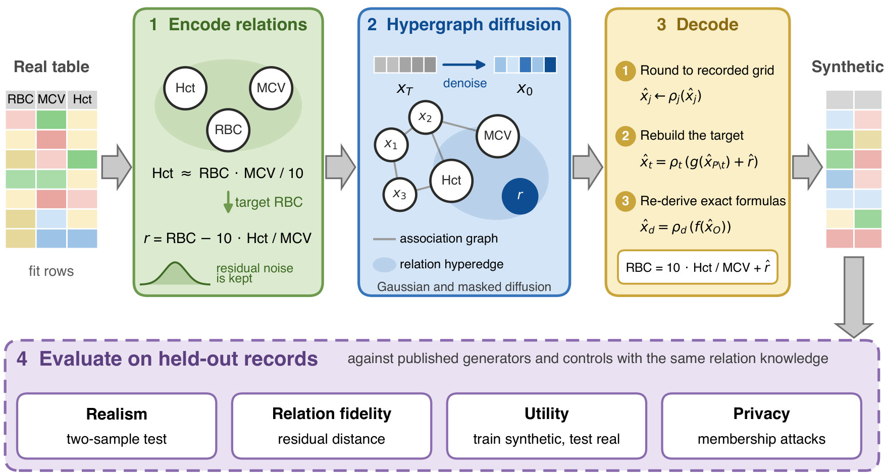

# MedHyperDiff

**Relation-aware diffusion for synthetic clinical laboratory tables**

[](LICENSE)


MedHyperDiff generates synthetic clinical tables that keep the formulas linking laboratory values, such as hematocrit = red cell count × mean corpuscular volume / 10. Each supplied relation is reparameterized: one participant is replaced by a residual, a mixed-type diffusion model generates the remaining variables and the residuals, and decoding rounds every value to its recorded resolution, rebuilds the replaced participant and re-derives relations that laboratories compute exactly.

This repository contains the model, the experiments and the results of the accompanying study. The study has two parts:
- a controlled study of seven training and evaluation pitfalls that change which synthetic data generator appears best on small clinical tables;
- an evaluation of relation reparameterization on five NHANES datasets from four survey cycles, against TabDiff, TabDDPM, CTGAN, TVAE, a Gaussian copula, and post-processing controls that use the same knowledge of the relations.



## Main findings

- Correcting the training and evaluation pipeline reversed 25% to 34% of generator pairs and changed the top-ranked generator in 18 of 20 training samples. The training effect came from an epoch cap that left small tables undertrained, not from validation-based checkpoint selection.
- Laboratory formulas computed exactly from reported values are reproduced best by recomputing them. Approximate formulas, such as the red cell indices, need residuals that are kept and sampled jointly.
- MedHyperDiff reproduced the approximate blood count relations most closely in every setting, by a small margin over joint resampling of real residuals. It was the most realistic generator below a membership AUROC of 0.60 in five of ten settings, all at 250 or 1000 records; TabDiff or simple controls were as realistic or more elsewhere.
- Membership attacks are diagnostics, not privacy guarantees, and the contribution of the hypergraph itself was not isolated.

## Repository structure

| Path | Contents |
|---|---|
| `src/medhyperdiff/` | The Python package: preprocessing, relation reparameterization (`relations.py`), the diffusion model (`diffusion.py`), baselines and evaluation |
| `scripts/` | Data download, experiment runners (`iteration*.py`), post hoc controls, reports and figures |
| `configs/` | Experiment configurations, frozen data splits and the configurations chosen by prespecified rules |
| `docs/` | Dated study protocols and runbooks for every iteration (see [docs/README.md](docs/README.md)) |
| `reports/` | Results and interpretation of every iteration; `reports/final/` holds the final comparison |
| `reproducibility/` | Archived source snapshots and scripts for each study, and the data behind every figure (`figure_inputs/`) |
| `paper/` | The manuscript (LaTeX source, references, compiled PDF) and its figures |
| `tests/` | Unit and regression tests |
| `external/` | Pinned upstream TabDiff and TabDDPM sources (git submodules) |

## Installation

Python 3.11 to 3.13 is supported. The experiments were run on CPU; `requirements-lock.txt` pins the verified dependency versions.

```bash
git clone --recurse-submodules https://github.com/NarenTheNumpkin/MHD.git
cd MHD
uv venv --python 3.13 .venv
uv pip install --python .venv/bin/python -r requirements-lock.txt
uv pip install --python .venv/bin/python --no-deps -e .
```

With plain `pip`, use `python -m venv .venv`, then `pip install -r requirements-lock.txt` and `pip install --no-deps -e .`. If the repository was cloned without `--recurse-submodules`, run `git submodule update --init` to fetch the pinned baselines.

Run the tests:

```bash
.venv/bin/python -m pytest -q
```

## Data

All data are public and de-identified, and none are redistributed here. The download script retrieves the NHANES public-use files and the UCI datasets, checks their SHA-256 digests and builds every processed dataset used in the study:

```bash
.venv/bin/python scripts/fetch_data.py
```

| Dataset | Source |
|---|---|
| NHANES 2011 to 2012, 2013 to 2014, 2015 to 2016, 2017 to 2018 and 2021 to 2023 | [National Center for Health Statistics](https://wwwn.cdc.gov/nchs/nhanes/) |
| Thyroid disease | [UCI 102](https://doi.org/10.24432/C5D010) |
| Indian Liver Patient Dataset | [UCI 225](https://doi.org/10.24432/C5D02C) |
| Heart failure clinical records | [UCI 519](https://doi.org/10.24432/C5Z89R) |
| Chronic kidney disease | [UCI 336](https://doi.org/10.24432/C5G020) |
| Early-stage diabetes risk prediction | [UCI 529](https://doi.org/10.24432/C5VG8H) |

NHANES public-use data may be used only for statistical reporting and analysis.

## Reproducing the study

The runners write their outputs to `runs/`. The dated protocol of each study, written before its generators were fitted, is linked in the last column.

| Study | Commands | Protocol |
|---|---|---|
| Development case study | `python scripts/iteration11.py ablation`, then `search`, `select`, `guidance`, `confirm` | [ITERATION_11](docs/ITERATION_11_PROTOCOL.md) |
| Controlled study of the pitfalls | `python scripts/iteration12.py prepare`, `run --workers 5`, then `python scripts/report_iteration12.py` | [ITERATION_12](docs/ITERATION_12_PROTOCOL.md) |
| Decomposition of the training correction | `python scripts/iteration15.py run --workers 8`, then `report` | [ITERATION_15](docs/ITERATION_15_PROTOCOL.md) |
| First relation test (2017 to 2018 blood counts) | `python scripts/iteration13.py prepare`, `develop`, `choose`, `confirm`, then `python scripts/report_iteration13.py` | [ITERATION_13](docs/ITERATION_13_PROTOCOL.md) |
| Robustness across survey cycles | `python scripts/iteration14.py prepare`, `queue --workers 8`, `choose`, `confirm --arms mhd`, then `python scripts/report_iteration14.py` | [ITERATION_14](docs/ITERATION_14_PROTOCOL.md) |
| Knowledge-equivalent controls | `python scripts/controls_iteration14.py run --workers 8` and `python scripts/reanalysis_iteration14.py relations`, `canonical`, `report` | |
| Final comparison | `python scripts/report_final.py <table folder>` | |
| Figure 1 | `python scripts/figure_overview.py <figure folder>` | |
| Figures 2 to 8 | `python scripts/figures_paper.py reproducibility/figure_inputs <figure folder>` | |

## Results behind the paper

The aggregated results from which every table and figure of the manuscript is computed are in `reproducibility/figure_inputs/` and `reports/final/`, as CSV files. Each row is one training sample, generator and post-processing; no participant-level records are included. [reproducibility/figure_inputs/README.md](reproducibility/figure_inputs/README.md) maps each file to the tables and figures it supports.

## Citation

The manuscript is in [paper/](paper/) and is under review. Until it is published, please cite the software using [CITATION.cff](CITATION.cff):

> Medarametla N, K G A, Parveen R, K P. MedHyperDiff: relation-aware diffusion for synthetic clinical laboratory tables. 2026. https://github.com/NarenTheNumpkin/MHD

## License

The code is released under the [MIT License](LICENSE). The pinned TabDiff and TabDDPM sources in `external/` keep their own MIT licenses. The datasets remain under the terms of their sources.

## Authors

Naren Medarametla, Abishek K G, Roshan Parveen and Parkavi K, School of Computer Science and Engineering, Vellore Institute of Technology, Chennai, India. Correspondence: parkavi.k@vit.ac.in.
