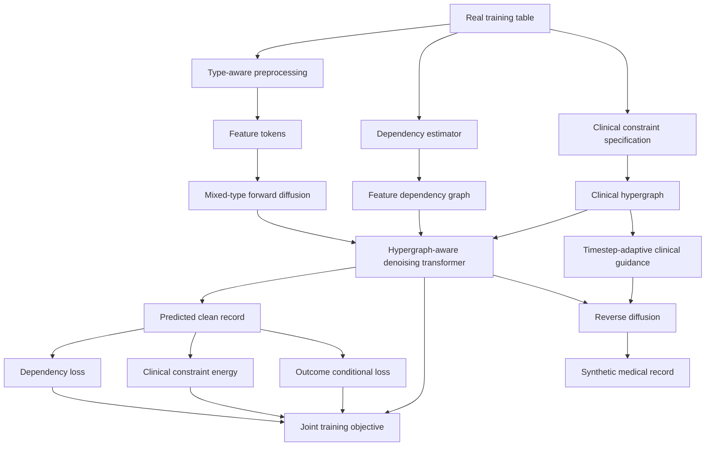

# MedHyperDiff: Clinical Hypergraph-Guided Mixed-Type Diffusion for Synthetic Medical Tabular Data

## Research Proposal and Experimental Plan

**Status:** Proposed research direction  
**Primary objective:** Develop a novel, publishable architecture for synthetic medical tabular data generation  
**Recommended model name:** **MedHyperDiff**  
**Core idea:** Integrate feature-level clinical dependency structure and uncertainty-aware clinical constraints directly into a mixed-type diffusion generator

---

## 1. Executive Recommendation

The recommended research direction is **not** to modify CTGAN with a small architectural change. CTGAN should be retained as an important baseline.

The proposed research contribution is a new diffusion-based generator named **MedHyperDiff: Clinical Hypergraph-Guided Mixed-Type Diffusion for Synthetic Medical Tabular Data**.

MedHyperDiff is designed around a specific limitation of generic tabular generators: a synthetic record can have realistic individual feature distributions while still violating clinically meaningful multivariate relationships. Medical variables are not independent columns. They participate in physiological, biochemical, logical, and disease-conditional relationships.

The proposed architecture therefore models a medical table using two complementary structures:

1. **A data-derived feature dependency graph**, which describes pairwise statistical relationships between variables.
2. **A clinical constraint hypergraph**, which describes relationships that can involve two or more variables and can represent hard or soft clinical rules.

These structures are integrated into a mixed-type diffusion model rather than being used only for post-generation filtering.

The principal novelty should be positioned as:

> **A feature-level clinical hypergraph that guides both representation learning and reverse diffusion using uncertainty-weighted, timestep-adaptive constraint energy.**

This positioning is deliberately more specific than "graph-guided diffusion." Recent work already includes mixed-type diffusion, causal-aware diffusion, dependency-preserving frameworks, graph-guided clinical diffusion based on patient similarity, and post-generation clinical constraint handling. The proposed work must therefore distinguish itself by modeling **feature-level multivariate clinical structure inside the generative process**.

---

# 2. Problem Statement

Synthetic medical tabular data can help address limited data availability, privacy concerns, class imbalance, and restrictions on sharing patient-level records. However, existing tabular generative models can produce data that are statistically similar to the original dataset without correctly preserving medically meaningful relationships between features.

Consider a medical record

\[
x = (x_1,x_2,\ldots,x_d),
\]

where each variable can have a different data type and clinical meaning. Generic synthetic data generators attempt to approximate

\[
p(x_1,x_2,\ldots,x_d).
\]

For medical data, matching the marginal distributions

\[
p(x_i)
\]

is insufficient. A useful generator should also preserve relationships such as

\[
p(x_i,x_j),
\]

disease-conditional structure

\[
p(X\mid Y),
\]

and higher-order clinical relationships

\[
p(x_i,x_j,x_k,\ldots).
\]

For example, laboratory variables can be connected through biochemical relationships, categorical variables can follow logical dependencies, and combinations of findings can be inconsistent even when every individual value is within a valid range.

Recent research has shown that state-of-the-art synthetic tabular generators can fail to preserve functional dependencies and other inter-attribute relationships. Clinical synthetic-data studies also continue to report violations of domain constraints even after generator optimization.

The research problem is therefore:

> **How can a mixed-type generative model explicitly preserve clinically meaningful feature dependencies and multivariate constraints while maintaining statistical fidelity, downstream machine-learning utility, and acceptable privacy risk?**

---

# 3. Research Gap

Several nearby research directions already exist and must be separated from the proposed contribution.

## 3.1 Mixed-Type Diffusion Already Exists

TabDiff introduced a joint continuous-time diffusion framework for numerical and categorical variables with feature-wise learnable diffusion processes. Therefore, using diffusion for mixed tabular data is not itself novel.

## 3.2 Causal-Aware Tabular Diffusion Already Exists

CausalDiffTab introduces causal regularization into mixed-type tabular diffusion. Therefore, adding only a learned causal graph or causal penalty would not provide a sufficiently clear contribution.

## 3.3 Dependency Preservation Has Recently Been Studied

Recent work demonstrated that generative models can fail to preserve functional and logical dependencies. The Hierarchical Feature Generation Framework, HFGF, improves dependency preservation by generating independent variables and then reconstructing dependent variables according to dependency structure.

This establishes dependency preservation as an important research problem, but HFGF is structurally different from the proposed approach because it performs hierarchical feature reconstruction rather than integrating a clinical hypergraph into an end-to-end diffusion denoiser.

## 3.4 Graph-Guided Clinical Diffusion Already Exists

TabGraphSyn uses a patient similarity graph and graph neural network embeddings to guide latent diffusion for clinical tabular data.

Therefore, a paper should not claim novelty based only on "GNN + diffusion."

The distinction proposed here is:

- TabGraphSyn models **relationships between patients**.
- MedHyperDiff models **relationships between medical features** and **multivariate clinical rules**.

## 3.5 Clinical Constraint Handling Already Exists

Recent clinical synthetic-data work has evaluated preprocessing, postprocessing, rejection sampling, repair, Best-of-N sampling, and other constraint mechanisms.

The proposed contribution should therefore avoid being only:

> Generate a record, detect invalid rows, and repair or reject them.

Instead, clinical structure should influence the **denoising trajectory itself**.

---

# 4. Proposed Novel Contribution

## 4.1 Proposed Model

**MedHyperDiff: Clinical Hypergraph-Guided Mixed-Type Diffusion**

The architecture contains six principal components:

1. Type-aware feature tokenization
2. Data-derived feature dependency graph
3. Clinical constraint hypergraph
4. Hypergraph-aware transformer denoiser
5. Mixed-type diffusion process
6. Uncertainty-weighted and timestep-adaptive clinical guidance

An optional seventh component performs disease or outcome conditional generation.

---

# 5. Core Research Questions

### RQ1: Dependency Preservation

Can explicit feature-level dependency modeling improve preservation of pairwise and higher-order medical relationships compared with generic tabular generators?

### RQ2: Clinical Validity

Can clinical hypergraph guidance reduce hard and soft clinical constraint violations without requiring destructive post-generation filtering?

### RQ3: Statistical Fidelity

Does structural guidance preserve or improve marginal and multivariate statistical fidelity?

### RQ4: Predictive Utility

Can models trained on MedHyperDiff-generated data maintain predictive performance when evaluated on untouched real patients?

### RQ5: Privacy

Does the additional structural modeling improve synthetic-data quality without increasing memorization or record-level privacy risk?

### RQ6: Heterogeneous Data Regimes

Does the method remain effective across numerical-heavy, mixed-type, missing-value-heavy, and categorical-heavy clinical datasets?

---

# 6. Hypotheses

### H1

MedHyperDiff will produce lower feature-dependency error than CTGAN, TVAE, CTAB-GAN+, TabDDPM, and a base mixed-type diffusion model.

### H2

MedHyperDiff will produce a significantly lower clinical constraint violation rate than unconstrained generative baselines.

### H3

The reduction in constraint violations will not require a substantial loss in marginal statistical fidelity.

### H4

The Train-on-Synthetic-Test-on-Real, TSTR, performance of MedHyperDiff will be comparable to or better than the strongest synthetic-data baseline.

### H5

Timestep-adaptive guidance will outperform constant-strength constraint guidance because strong constraints applied during the earliest noisy diffusion steps can unnecessarily restrict exploration of the data distribution.

### H6

Hypergraph constraints will outperform only pairwise dependency guidance on datasets containing clinically meaningful multivariate relationships.

---

# 7. Research Goals

## Primary Goal

Develop and validate a new medical tabular synthetic-data architecture that explicitly integrates clinical dependency structure into mixed-type diffusion generation.

## Secondary Goals

1. Quantify the relationship between statistical fidelity and clinical validity.
2. Determine whether improved clinical validity leads to improved downstream predictive utility.
3. Evaluate whether dependency preservation varies according to dataset structure.
4. Measure privacy risk rather than assuming that synthetic data are automatically anonymous.
5. Determine the contribution of every proposed architectural component through ablation experiments.
6. Produce a reproducible evaluation framework that can be used on additional medical datasets.

---

# 8. Datasets

The four selected UCI datasets should be retained as the **initial benchmark suite**. They should be treated independently rather than merged.

| Dataset | Instances | Predictors | Main data characteristics | Target |
|---|---:|---:|---|---|
| Heart Failure Clinical Records | 299 | 12 | Numerical clinical measurements plus binary indicators | Death event |
| Indian Liver Patient Dataset, ILPD | 583 | 10 | Biochemical continuous variables plus demographic variables | Liver disease |
| Chronic Kidney Disease | 400 | 24 | Mixed numerical and categorical variables with substantial missingness | CKD / not CKD |
| Early Stage Diabetes Risk Prediction | 520 | 16 | Primarily binary symptom variables with age and gender | Positive / negative |

## 8.1 Dataset Roles

The four datasets provide different stress conditions for the generator.

### Heart Failure

Useful for testing:

- small-sample generation,
- numerical distributions,
- binary comorbidities,
- disease-outcome conditioning,
- relationships involving ejection fraction, serum creatinine, serum sodium, age, and mortality.

### ILPD

Useful for testing:

- biochemical relationships,
- correlated continuous variables,
- multivariate clinical constraints,
- disease-conditional biochemical distributions.

Examples of potentially testable relationships include relationships among:

- total bilirubin,
- direct bilirubin,
- albumin,
- total proteins,
- albumin/globulin ratio,
- ALT/SGPT,
- AST/SGOT.

Any deterministic constraint used in the final study must be verified from authoritative clinical or dataset documentation before being encoded as a hard rule.

### Chronic Kidney Disease

Useful for testing:

- mixed data types,
- categorical variables,
- numerical laboratory values,
- missing data,
- logical relationships,
- strong association between laboratory findings and CKD status.

### Early Stage Diabetes Risk Prediction

Useful for testing:

- categorical-heavy generation,
- binary symptoms,
- class-conditional relationships,
- preservation of symptom co-occurrence patterns.

---

# 9. Recommendation on Dataset Expansion

The four UCI datasets are suitable for architecture development and initial experiments, but they are small. A publication will be stronger if the final evaluation includes at least **six datasets**, preferably including one or two datasets with several thousand records.

Recommended expansion options include publicly accessible clinical datasets such as:

- ACTG 175 AIDS clinical trial data,
- Wisconsin Breast Cancer data,
- additional well-documented clinical classification datasets,
- larger public clinical cohorts where licensing permits reproducible experiments.

If access requirements can be satisfied, a de-identified clinical dataset from PhysioNet can provide a stronger external validation experiment.

The final paper should ideally include:

\[
4\text{ small heterogeneous datasets}
+
2\text{ medium or larger clinical datasets}.
\]

The architecture should first be developed on the four UCI datasets. Additional datasets should be added only after the core methodology is stable.

---

# 10. Proposed Architecture

## 10.1 High-Level Pipeline



---

# 11. Component 1: Type-Aware Feature Tokenization

Medical tables contain different variable types.

Let feature \(x_i\) have type

\[
\tau_i \in
\{
\text{continuous},
\text{binary},
\text{categorical},
\text{ordinal}
\}.
\]

Each feature is converted into a token

\[
e_i = E_{\tau_i}(x_i) + E_{\text{feature}}(i),
\]

where:

- \(E_{\tau_i}\) is a type-specific encoder,
- \(E_{\text{feature}}\) identifies the semantic feature,
- optional metadata embeddings can represent units or feature groups.

Continuous values can use a numerical projection or learnable numerical embedding.

Categorical and binary variables use embedding tables.

Ordinal variables retain ordering information instead of being treated as unordered categories.

For a patient with \(d\) features, the resulting representation is

\[
E(x) \in \mathbb{R}^{d\times h},
\]

where \(h\) is the token dimension.

---

# 12. Component 2: Data-Derived Feature Dependency Graph

Construct a graph

\[
G_D=(V,E_D),
\]

where every node corresponds to one medical feature.

Because medical datasets contain mixed data types, one association measure should not be applied blindly to every pair.

Possible estimators include:

- Spearman or Pearson correlation for suitable continuous pairs,
- mutual information for nonlinear mixed relationships,
- Cramer's V for categorical pairs,
- point-biserial or mutual-information-based measures for continuous-binary pairs.

These estimates are normalized into an adjacency matrix

\[
A_D\in[0,1]^{d\times d}.
\]

Only the **training partition** is allowed to construct this structure.

No information from the outer real test fold can be used.

The purpose of the dependency graph is not to assert causality. It represents empirically observed feature association.

---

# 13. Component 3: Clinical Constraint Hypergraph

Pairwise graphs cannot naturally represent all medical relationships.

MedHyperDiff therefore introduces a clinical hypergraph

\[
H_C=(V,\mathcal{E}_C),
\]

where a hyperedge

\[
e_k\subseteq V
\]

can connect two or more variables.

For example, a relationship involving three laboratory measurements can be represented as:

\[
e_k = \{x_a,x_b,x_c\}.
\]

Each hyperedge stores:

\[
e_k = (\mathcal{V}_k, r_k, c_k, t_k),
\]

where:

- \(\mathcal{V}_k\) is the set of participating variables,
- \(r_k\) is a rule or differentiable relationship,
- \(c_k\in[0,1]\) is the confidence,
- \(t_k\) identifies whether the constraint is hard or soft.

## 13.1 Hard Constraints

Hard constraints represent relationships that should almost never be violated.

Examples include:

- legal category membership,
- physically impossible ranges,
- deterministic schema relationships,
- mathematically defined derived variables.

These receive high confidence:

\[
c_k \approx 1.
\]

## 13.2 Soft Constraints

Soft constraints represent strong tendencies rather than deterministic medical laws.

They can be estimated from training data or derived from validated clinical knowledge.

Examples include:

- typical relationships between laboratory measurements,
- disease-conditional trends,
- common symptom co-occurrences.

Soft constraints receive lower confidence.

The model must not convert ordinary clinical correlations into absolute rules.

---

# 14. Why a Hypergraph Instead of a Normal Graph?

A normal feature graph represents:

\[
x_i \leftrightarrow x_j.
\]

A hypergraph can directly represent:

\[
(x_i,x_j,x_k)\rightarrow r.
\]

This is valuable for medical data because clinical consistency frequently depends on a combination of measurements rather than one pair.

The proposed architecture therefore separates:

\[
\text{pairwise statistical dependency}
\]

from

\[
\text{multivariate clinical consistency}.
\]

This separation is a central design decision.

---

# 15. Component 4: Hypergraph-Aware Transformer Denoiser

A transformer denoiser processes feature tokens during diffusion.

Standard self-attention uses

\[
S_{ij}
=
\frac{Q_iK_j^T}{\sqrt{h}}.
\]

MedHyperDiff adds structural bias:

\[
S_{ij}^{*}
=
\frac{Q_iK_j^T}{\sqrt{h}}
+
\lambda_D A_{D,ij}
+
\lambda_H A_{H,ij},
\]

where:

- \(A_D\) is the data-derived dependency graph,
- \(A_H\) is a pairwise projection of the clinical hypergraph,
- \(\lambda_D\) and \(\lambda_H\) control structural influence.

A stronger implementation can use a dedicated hypergraph message-passing block before or between transformer layers:

\[
H^{(l+1)}
=
\text{TransformerBlock}
\left(
H^{(l)}
+
\text{HypergraphMessage}(H^{(l)},H_C)
\right).
\]

This allows multivariate clinical structures to influence the internal patient representation.

---

# 16. Component 5: Mixed-Type Diffusion

The diffusion backbone should support continuous and categorical variables.

For continuous variables, a standard Gaussian forward process can be written as

\[
q(x_t\mid x_{t-1})
=
\mathcal{N}
\left(
\sqrt{1-\beta_t}x_{t-1},
\beta_t I
\right).
\]

Categorical variables require an appropriate discrete or continuous-time categorical corruption process.

A practical implementation can adapt the mixed-type design principles used by modern models such as TabDiff instead of inventing an entirely new noise process.

The core contribution of MedHyperDiff is not the existence of mixed-type diffusion. It is the **clinical structural guidance layered into the denoising process**.

---

# 17. Component 6: Clinical Constraint Energy

For each predicted clean sample

\[
\hat{x}_0,
\]

define constraint-specific penalties

\[
\phi_k(\hat{x}_0).
\]

The clinical energy is

\[
E_C(\hat{x}_0)
=
\sum_{k=1}^{K}
c_k w_k \phi_k(\hat{x}_0),
\]

where:

- \(c_k\) is constraint confidence,
- \(w_k\) is an optional learned or tuned importance,
- \(\phi_k\) measures violation severity.

A hard numerical bound can use a hinge penalty.

For

\[
l_i \leq x_i \leq u_i,
\]

define

\[
\phi_i(x_i)
=
\max(0,l_i-x_i)
+
\max(0,x_i-u_i).
\]

For a relational constraint

\[
f(x_a,x_b,x_c)\leq 0,
\]

use

\[
\phi_k(x)
=
\max(0,f(x_a,x_b,x_c)).
\]

Categorical constraints can operate on predicted class probabilities using differentiable expected violations during training.

---

# 18. Timestep-Adaptive Constraint Guidance

This is one of the recommended novelty components.

During the earliest reverse-diffusion steps, the sample is highly noisy. Strong clinical guidance at this stage can excessively restrict exploration.

Clinical guidance should therefore vary with timestep.

Define

\[
\gamma(t)
\]

such that constraint strength is relatively weak at high-noise steps and becomes stronger as the sample approaches \(x_0\).

For example:

\[
\gamma(t)
=
\gamma_{\max}
\left(
1-\frac{t}{T}
\right)^p.
\]

During sampling:

\[
x_{t-1}
=
\text{Denoise}_{\theta}(x_t,t)
-
\eta\gamma(t)
\nabla_{x_t}E_C(\hat{x}_0).
\]

This produces:

```text
High-noise stage
    |
    | weak clinical guidance
    v
distribution exploration
    |
    | increasing guidance
    v
structure refinement
    |
    | strongest guidance
    v
clinically consistent synthetic record
```

Ablation experiments must compare this schedule against:

- no guidance,
- constant guidance,
- late-only guidance,
- proposed adaptive guidance.

---

# 19. Outcome-Conditional Generation

For datasets with a disease or outcome label \(Y\), learn

\[
p(X\mid Y)
\]

rather than generating \(X\) and \(Y\) independently.

A target embedding can be supplied to the denoiser:

\[
h_y = E_Y(y).
\]

The denoising model becomes

\[
\epsilon_\theta(x_t,t,G,H,y).
\]

This supports:

- controlled class generation,
- minority-class augmentation,
- preservation of disease-specific feature relationships.

Classifier-free guidance can optionally be investigated, but it should not be presented as a primary novelty contribution.

---

# 20. Proposed Training Objective

The complete objective can be:

\[
\mathcal{L}
=
\mathcal{L}_{diff}
+
\lambda_{dep}\mathcal{L}_{dep}
+
\lambda_{clin}\mathcal{L}_{clin}
+
\lambda_{cond}\mathcal{L}_{cond}.
\]

## 20.1 Diffusion Loss

For continuous noise prediction:

\[
\mathcal{L}_{diff}
=
\mathbb{E}
\left[
\|
\epsilon
-
\epsilon_\theta(x_t,t,H_C,G_D,y)
\|_2^2
\right].
\]

The categorical component uses the corresponding categorical diffusion objective.

## 20.2 Dependency Preservation Loss

One option is to compare minibatch differentiable association estimates:

\[
\mathcal{L}_{dep}
=
\left\|
A_{\text{real}}
-
A_{\text{pred}}
\right\|_F^2.
\]

Because mixed-type associations are not all differentiable, this component should initially be restricted to relationships for which a stable differentiable surrogate is available.

Dependency preservation should also be evaluated externally using non-differentiable metrics.

## 20.3 Clinical Constraint Loss

\[
\mathcal{L}_{clin}
=
\mathbb{E}
\left[
E_C(\hat{x}_0)
\right].
\]

## 20.4 Conditional Preservation Loss

An optional conditional loss can encourage the generated record to remain informative about the requested outcome.

Care must be taken not to optimize directly against the final downstream test classifier because this would contaminate utility evaluation.

---

# 21. Recommended Training Algorithm

```text
Input:
    Real training partition Dtrain
    Feature metadata M
    Clinical constraint definitions C
    Outcome labels Y

1. Fit preprocessing using Dtrain only.
2. Infer feature types.
3. Estimate mixed-type dependency matrix AD from Dtrain.
4. Construct clinical hypergraph HC from validated hard and soft constraints.
5. Initialize mixed-type diffusion denoiser.
6. Repeat for each training minibatch:
       a. Sample real records x0.
       b. Sample diffusion timestep t.
       c. Corrupt numerical and categorical variables to obtain xt.
       d. Encode xt as typed feature tokens.
       e. Apply dependency and hypergraph-aware denoising.
       f. Predict clean sample or diffusion noise.
       g. Compute diffusion loss.
       h. Compute differentiable dependency loss where applicable.
       i. Compute uncertainty-weighted clinical loss.
       j. Compute conditional loss if enabled.
       k. Update model parameters.
7. Select model using validation data from inside Dtrain.
8. Generate synthetic records using reverse diffusion.
9. Apply timestep-adaptive clinical energy guidance during sampling.
10. Decode and inverse-transform generated records.
11. Evaluate only against the untouched real outer test partition.
```

---

# 22. Data Splitting and Leakage Prevention

The experimental design must prevent synthetic generators from seeing real test patients.

Use **stratified outer 5-fold cross-validation**.

For fold \(k\):

\[
D
=
D_{\text{train}}^{(k)}
\cup
D_{\text{test}}^{(k)}.
\]

The generator is trained only on:

\[
D_{\text{train}}^{(k)}.
\]

Inside the training partition, create a generator validation split for hyperparameter selection.

A suitable structure is:

```text
Full dataset
    |
    +-- Outer fold training set
    |       |
    |       +-- Generator/model training
    |       |
    |       +-- Internal validation
    |
    +-- Outer fold real test set
            |
            +-- Never used to fit:
                    preprocessing
                    imputation
                    dependency graph
                    constraints estimated from data
                    generator
                    downstream classifier
```

Any imputation model, scaler, category mapping, dependency estimator, feature selector, or learned constraint must be fitted using only the training partition.

---

# 23. Missing-Value Handling

The CKD dataset contains missing values.

Missingness should be treated as an experimental variable rather than silently removed.

Two initial strategies can be compared:

### Strategy A: Training-Only Imputation

Fit numerical and categorical imputation using the training partition only.

### Strategy B: Missingness as Information

Add missingness indicators and allow the generator to model missingness patterns where technically supported.

The primary study should use one clearly defined strategy for all models to preserve fairness of comparison.

A secondary experiment can investigate whether MedHyperDiff preserves clinically structured missingness better than baseline generators.

---

# 24. Baseline Models

A publishable study should not compare only against CTGAN.

## Required Baselines

### 1. Gaussian Copula or Another Simple Statistical Generator

Purpose:

- establish a non-deep baseline,
- determine whether model complexity is genuinely necessary.

### 2. TVAE

Purpose:

- VAE-based deep generative baseline.

### 3. CTGAN

Purpose:

- widely used GAN-based tabular baseline,
- directly retains the original research direction.

### 4. CTAB-GAN+

Purpose:

- stronger GAN-family baseline for mixed tabular data.

### 5. TabDDPM

Purpose:

- established diffusion baseline.

### 6. TabDiff

Purpose:

- strong modern mixed-type diffusion baseline.

## Strong Additional Baselines if Implementation Is Feasible

### 7. CausalDiffTab

Important because it is directly related to structural regularization in mixed-type diffusion.

### 8. HFGF

Important because it explicitly targets dependency preservation.

### 9. TabGraphSyn

Important medical graph-diffusion comparison.

The paper does not need every baseline if reproducibility becomes impractical, but CTGAN, TVAE, CTAB-GAN+, TabDDPM, TabDiff, and one simple statistical model should be treated as the minimum robust comparison set.

---

# 25. Ablation Study

The ablation study is essential for demonstrating that performance is caused by the proposed components.

| Model | Dependency Graph | Clinical Hypergraph | Training Constraint Loss | Adaptive Sampling Guidance | Outcome Conditioning |
|---|---|---|---|---|---|
| Base Diffusion | No | No | No | No | No |
| + Dependency | Yes | No | No | No | No |
| + Hypergraph | No | Yes | Yes | No | No |
| + Constant Guidance | Yes | Yes | Yes | Constant | No |
| + Adaptive Guidance | Yes | Yes | Yes | Adaptive | No |
| MedHyperDiff | Yes | Yes | Yes | Adaptive | Yes |

Additional ablations:

1. pairwise graph versus hypergraph,
2. hard constraints only versus hard + soft constraints,
3. manually verified constraints versus data-derived constraints,
4. fixed confidence versus learned or estimated confidence,
5. constant guidance versus timestep-adaptive guidance.

---

# 26. Evaluation Framework

Evaluation should cover five primary dimensions:

\[
\boxed{
\text{Fidelity}
+
\text{Dependency Preservation}
+
\text{Clinical Validity}
+
\text{Utility}
+
\text{Privacy}
}
\]

A sixth optional dimension is fairness.

---

# 27. Statistical Fidelity

## 27.1 Univariate Numerical Fidelity

For continuous features:

- Wasserstein distance,
- Kolmogorov-Smirnov statistic,
- quantile error,
- mean and standard deviation error.

For each feature \(j\):

\[
W_j
=
W_1
\left(
P_{\text{real}}(x_j),
P_{\text{syn}}(x_j)
\right).
\]

Report both per-feature values and dataset-level averages.

## 27.2 Categorical Fidelity

Use:

- Jensen-Shannon divergence,
- total variation distance,
- category coverage,
- frequency error.

## 27.3 Multivariate Fidelity

Use:

- pairwise correlation distance,
- mixed-type association matrix error,
- covariance error where appropriate,
- classifier two-sample test, C2ST.

For an association matrix \(A\):

\[
E_A
=
\frac{
\|A_{\text{real}}-A_{\text{syn}}\|_F
}{
d^2
}.
\]

## 27.4 Distribution Coverage

Where feasible, include modern metrics such as:

- alpha-precision,
- beta-recall,
- authenticity.

This helps distinguish memorization from meaningful distribution coverage.

---

# 28. Dependency Preservation Evaluation

This should be one of the central result sections.

## 28.1 Pairwise Dependency Error

Compare real and synthetic mixed-type association matrices.

## 28.2 Logical Dependency Preservation

Extract logical dependencies from real training data and measure the fraction preserved in synthetic data.

A recent Pattern Recognition study provides a useful methodological foundation for functional and logical dependency evaluation.

## 28.3 Functional Dependency Preservation

For datasets containing valid functional relationships:

\[
FD\text{-Preservation}
=
\frac{
\text{FDs preserved in synthetic data}
}{
\text{FDs detected in real data}
}.
\]

## 28.4 Hyperedge Consistency

For each hypergraph constraint \(k\):

\[
V_k
=
\frac{
\#\text{ synthetic records violating }k
}{
N_{\text{synthetic}}
}.
\]

Report:

- per-constraint violation rate,
- macro-average violation rate,
- confidence-weighted violation severity.

---

# 29. Clinical Validity

Define:

\[
CVR
=
\frac{
\text{number of invalid synthetic records}
}{
N_{\text{synthetic}}
}.
\]

However, a binary valid/invalid metric can hide severity.

Also report:

\[
CVS
=
\frac{1}{N}
\sum_{i=1}^{N}
\sum_{k=1}^{K}
c_k\phi_k(x_i).
\]

This gives the **Clinical Violation Severity**.

Recommended clinical-validity outputs:

- hard constraint violation rate,
- soft constraint violation score,
- percentage of fully valid synthetic records,
- violations per 1,000 synthetic records,
- class-conditional validity,
- constraint-specific plots.

All clinical constraints used for final claims must be justified from authoritative documentation or expert-reviewed knowledge.

---

# 30. Machine-Learning Utility

Use three evaluation regimes.

## 30.1 TRTR

**Train on Real, Test on Real**

This is the real-data reference.

\[
M_R
=
Train(D_{\text{real train}})
\]

and evaluate on untouched real test data.

## 30.2 TSTR

**Train on Synthetic, Test on Real**

\[
M_S
=
Train(D_{\text{synthetic}})
\]

and evaluate on the same untouched real test data.

Define a utility gap:

\[
\Delta U
=
U_{TRTR}
-
U_{TSTR}.
\]

Smaller positive values are preferable.

## 30.3 Real + Synthetic Augmentation

Evaluate:

\[
D_{\text{aug}}
=
D_{\text{real train}}
\cup
D_{\text{synthetic}}.
\]

Recommended synthetic ratios:

\[
0.5\times,\quad
1\times,\quad
2\times,\quad
5\times.
\]

This tests whether synthetic generation provides useful augmentation rather than only replication.

---

# 31. Downstream Classifiers

Use classifiers with different inductive biases:

1. Logistic Regression
2. Random Forest
3. XGBoost

Optional:

4. Multilayer Perceptron

Report:

- AUROC,
- AUPRC,
- F1,
- balanced accuracy,
- sensitivity,
- specificity.

Accuracy should not be the primary metric for imbalanced medical datasets.

---

# 32. Privacy Evaluation

Synthetic medical data must not be assumed to be private simply because rows are artificial.

At minimum evaluate:

## 32.1 Exact Match Rate

\[
EMR
=
\frac{
|\{s:s\in S\cap R\}|
}{
|S|
}.
\]

## 32.2 Distance to Closest Record

For synthetic sample \(s\):

\[
DCR(s)
=
\min_{r\in R}
d(s,r).
\]

## 32.3 Nearest Neighbor Distance Ratio

\[
NNDR
=
\frac{d_1}{d_2}.
\]

## 32.4 Membership Inference

Estimate whether an attacker can determine whether a real patient participated in generator training.

## 32.5 Attribute Inference

Estimate whether sensitive variables can be inferred from partial synthetic or auxiliary information.

## 32.6 Anonymeter

If technically compatible with the preprocessing pipeline, evaluate:

- singling-out risk,
- linkability risk,
- inference risk.

Privacy metrics must compare training records against a real holdout set to distinguish memorization from naturally dense regions of the population distribution.

---

# 33. Optional Fairness Evaluation

Fairness should not be the central contribution unless sufficient subgroup sizes exist.

However, demographic variables such as sex are present in several datasets.

A secondary audit can measure whether synthetic generation changes:

- subgroup representation,
- target prevalence by subgroup,
- classifier sensitivity by subgroup,
- equalized-odds-related gaps.

This is particularly relevant to ILPD because healthcare prediction bias by sex has been studied using this dataset.

If subgroup counts are too small, report the analysis as exploratory rather than making strong fairness claims.

---

# 34. Statistical Analysis

Each stochastic generator should be trained using at least **three independent random seeds**.

Five seeds are preferable if computationally feasible.

For each dataset:

\[
5\text{ outer folds}
\times
3\text{ seeds}
\]

produces:

\[
15
\]

generator evaluations per architecture.

Report:

\[
\text{mean}\pm\text{standard deviation}.
\]

For important pairwise comparisons between MedHyperDiff and the strongest baseline, use an appropriate paired statistical test across matched folds and seeds.

Possible choices:

- Wilcoxon signed-rank test,
- paired t-test when assumptions are justified.

Also report effect sizes where possible.

Do not interpret very small p-values as evidence of practical importance without reporting the magnitude of improvement.

---

# 35. Main Experiment Matrix

A complete experiment can become computationally large.

The recommended staged matrix is:

## Stage A: Architecture Development

Datasets:

- Heart Failure
- ILPD

Models:

- Base diffusion
- MedHyperDiff ablations

Purpose:

- debug architecture,
- tune guidance,
- verify hypergraph construction.

## Stage B: Heterogeneous Validation

Datasets:

- CKD
- Early Stage Diabetes

Freeze major architecture decisions before this stage.

Purpose:

- evaluate generalization to different feature regimes.

## Stage C: Full Benchmark

Datasets:

- all four primary datasets,
- additional public datasets if feasible.

Models:

- statistical baseline,
- TVAE,
- CTGAN,
- CTAB-GAN+,
- TabDDPM,
- TabDiff,
- MedHyperDiff.

Add related structural baselines when implementation quality is sufficient.

---

# 36. Example Constraint Design by Dataset

These are **research-design examples**, not final medical rules. Every final constraint must be checked against authoritative clinical knowledge and the exact dataset semantics.

## 36.1 Heart Failure

Possible hard constraints:

- binary variables must remain binary,
- ejection fraction must remain in a physically valid percentage range,
- follow-up time must be non-negative,
- laboratory variables that cannot be negative must remain non-negative.

Possible soft dependencies:

- outcome-conditional relationships involving serum creatinine,
- outcome-conditional relationships involving ejection fraction,
- age and mortality associations.

## 36.2 ILPD

Potential structural relationships:

- total and direct bilirubin consistency,
- relationships among total protein, albumin, and albumin/globulin ratio,
- liver enzyme co-variation,
- disease-conditional biochemical profiles.

Relationships involving derived quantities are particularly valuable for testing hypergraph constraints.

## 36.3 CKD

Possible structures:

- categorical domain validity,
- disease-conditional laboratory relationships,
- relationships among hemoglobin, packed cell volume, and red blood cell count,
- associations involving creatinine, blood urea, and CKD status,
- relationships among hypertension, diabetes, and CKD status.

## 36.4 Diabetes Risk

Possible structures:

- binary domain validity,
- symptom co-occurrence,
- disease-conditional symptom patterns,
- age-dependent symptom distributions.

The diabetes dataset may contain fewer deterministic numerical relationships, making it useful for testing whether the architecture still works when most constraints are soft and categorical.

---

# 37. Success Criteria

The model does **not** need to achieve the best score on every individual metric.

A credible research success criterion is:

### Primary Success

MedHyperDiff significantly improves:

- dependency preservation,
- clinical constraint validity,

relative to the base diffusion model and major generic baselines.

### Utility Requirement

TSTR AUROC or AUPRC should remain close to the strongest baseline.

A practical target is:

\[
|\Delta U|
\leq 0.05
\]

relative to the strongest relevant generator on most datasets, while achieving clear structural-validity improvements.

### Fidelity Requirement

Marginal fidelity should not substantially deteriorate in exchange for clinical validity.

### Privacy Requirement

MedHyperDiff must not demonstrate materially greater memorization risk than the best-performing non-private baselines.

A model that improves clinical validity by reproducing training records is not successful.

---

# 38. What Would Constitute a Strong Paper Result?

A particularly compelling result would look like:

| Model | Fidelity | Dependency Error | Clinical Violation Rate | TSTR AUROC | Privacy Risk |
|---|---:|---:|---:|---:|---:|
| CTGAN | strong | high | high | moderate | moderate |
| TabDDPM | strong | moderate | moderate | strong | moderate |
| TabDiff | very strong | moderate | moderate | strong | moderate |
| Base Diffusion | strong | moderate | moderate | strong | moderate |
| **MedHyperDiff** | strong | **low** | **very low** | strong | comparable |

The core argument would then be:

> Generic generators reproduce distributions, but explicit feature-level medical structure substantially improves semantic and clinical consistency without sacrificing downstream usefulness.

This is a stronger scientific claim than:

> Our model obtained the highest average quality score.

---

# 39. Novelty Positioning

The paper should position the contribution carefully.

| Existing Direction | What It Already Does | MedHyperDiff Differentiation |
|---|---|---|
| CTGAN | Conditional GAN for mixed tabular distributions | Diffusion backbone with explicit clinical structure |
| TabDDPM | Diffusion for tabular generation | Adds feature-level medical dependency and hypergraph guidance |
| TabDiff | Feature-wise mixed-type diffusion | Clinical hypergraph and constraint-guided denoising |
| CausalDiffTab | Causal-aware mixed-type diffusion | Focuses on uncertainty-weighted clinical hyperedges and explicit validity guidance rather than only causal regularization |
| HFGF | Preserves functional/logical dependencies through hierarchical reconstruction | Integrates structural information into end-to-end denoising rather than reconstructing dependent columns afterward |
| TabGraphSyn | Patient-similarity graph + GNN + latent diffusion | Models feature-to-feature and multivariate clinical relationships, not patient neighborhood geometry |
| Constraint-aware GAN / Best-of-N approaches | Improve validity through penalties, repair, selection, or rejection | Uses timestep-adaptive clinical energy inside reverse diffusion |

The novelty claim should therefore be phrased approximately as:

> **We propose a mixed-type diffusion architecture in which feature-level clinical dependency structure is represented as a confidence-weighted hypergraph and incorporated into both denoiser attention and timestep-adaptive reverse-diffusion guidance.**

Before paper submission, perform another systematic novelty search using the final exact components and terminology. Novelty is a moving target, especially in tabular diffusion research.

---

# 40. Expected Contributions

A strong final paper can claim the following contributions if experimentally supported.

## C1. Clinical Hypergraph Representation

A representation for combining pairwise empirical dependencies with higher-order hard and soft clinical relationships.

## C2. Hypergraph-Aware Mixed-Type Denoising

A transformer-based denoiser whose feature interactions are conditioned by clinical structure.

## C3. Uncertainty-Weighted Clinical Energy

A mechanism that distinguishes deterministic constraints from uncertain clinical associations.

## C4. Timestep-Adaptive Clinical Guidance

A reverse-diffusion strategy that progressively increases clinical guidance as generation approaches the clean sample.

## C5. Multi-Dimensional Medical Synthetic-Data Evaluation

A benchmark covering:

- fidelity,
- dependency preservation,
- clinical validity,
- utility,
- privacy.

## C6. Cross-Regime Evaluation

Validation across numerical-heavy, biochemical, mixed/missing, and categorical-heavy clinical datasets.

---

# 41. Risks and Mitigation

## Risk 1: Four UCI Datasets Are Too Small

**Problem:** Deep diffusion models can overfit small datasets.

**Mitigation:**

- use simple baselines,
- use strong regularization,
- repeat experiments across seeds,
- expand final evaluation to larger datasets,
- explicitly study small-data behavior rather than hiding it.

## Risk 2: Constraints Are Incorrect

**Problem:** Incorrect medical rules can force the generator toward unrealistic data.

**Mitigation:**

- distinguish hard from soft rules,
- assign confidence,
- validate rules from authoritative sources,
- perform rule-specific ablation,
- never infer medical causality from correlation alone.

## Risk 3: Architecture Becomes Too Complex

**Problem:** Combining diffusion, transformers, graphs, hypergraphs, and clinical guidance can make the contribution difficult to isolate.

**Mitigation:**

Implement incrementally:

1. base mixed-type diffusion,
2. dependency bias,
3. clinical hypergraph,
4. constraint loss,
5. adaptive sampling guidance.

Do not add unrelated components unless an ablation identifies a clear need.

## Risk 4: Improvement Comes Only From Postprocessing

**Problem:** Reviewers can argue that validity improvement is caused by filtering rather than generation.

**Mitigation:**

Do not use strict rejection or repair as the primary proposed method.

Include postprocessing as an external comparison if desired.

## Risk 5: Generator Memorization

**Problem:** Small medical datasets can cause memorization.

**Mitigation:**

- DCR,
- NNDR,
- membership inference,
- holdout comparisons,
- early stopping,
- privacy-aware regularization as future work.

## Risk 6: Metric Gaming

**Problem:** Optimizing one fidelity metric can hurt utility or privacy.

**Mitigation:**

Use a multi-dimensional evaluation and report trade-offs rather than a single composite quality score as the only result.

---

# 42. Recommended Implementation Strategy

## Phase 1: Reproduce Baselines

Implement and verify:

- Gaussian Copula,
- TVAE,
- CTGAN,
- CTAB-GAN+,
- TabDDPM,
- TabDiff.

Create one unified evaluation pipeline.

Do not start the proposed architecture until baseline evaluation is reproducible.

## Phase 2: Base Mixed-Type Diffusion

Build or adapt a minimal mixed-type diffusion implementation.

Verify:

- sampling,
- inverse transformation,
- categorical validity,
- numerical fidelity,
- conditional generation.

## Phase 3: Dependency Layer

Implement mixed-type association estimation.

Add dependency-aware attention.

Run the first ablation:

\[
\text{Base Diffusion}
\quad vs \quad
\text{Dependency Diffusion}.
\]

## Phase 4: Clinical Hypergraph

Implement:

- hyperedge representation,
- hard constraints,
- soft constraints,
- confidence scores,
- differentiable violation functions.

## Phase 5: Training-Time Constraint Loss

Add:

\[
\mathcal{L}_{clin}.
\]

Check whether validity improves without collapsing diversity.

## Phase 6: Adaptive Reverse-Diffusion Guidance

Implement:

\[
\gamma(t).
\]

Compare no, constant, and adaptive guidance.

## Phase 7: Outcome Conditioning

Add class-conditional synthesis.

Test minority-class augmentation.

## Phase 8: Full Benchmark

Run all folds, seeds, models, utility experiments, privacy attacks, and statistical tests.

---

# 43. Recommended Minimal Version for the First Paper

Avoid making the first version too large.

The minimum publishable proposed architecture should contain only:

1. mixed-type diffusion backbone,
2. feature dependency graph,
3. clinical hypergraph,
4. uncertainty-weighted constraint energy,
5. timestep-adaptive reverse-diffusion guidance.

Outcome conditioning is valuable but can be treated as a standard supporting mechanism.

Differential privacy should **not** be added to Version 1 unless the core generator is already stable.

A second paper or extension can investigate formal differential privacy.

---

# 44. What Not to Do

Avoid the following study designs.

## Do Not Merge Unrelated Medical Datasets

Heart, liver, kidney, and diabetes records do not share a common clinical schema.

Train generators independently on each dataset.

## Do Not Use CTGAN Alone as the Contribution

CTGAN is a baseline, not the novelty.

## Do Not Claim Privacy Without Testing It

Synthetic does not automatically mean anonymous.

## Do Not Evaluate Only Histograms

Marginal similarity can coexist with invalid multivariate relationships.

## Do Not Evaluate Only Classification Accuracy

The project is about a generator, not only a classifier.

## Do Not Encode Correlation as Medical Causality

The data-derived dependency graph should be described as an association structure unless causal assumptions are independently justified.

## Do Not Hard-Code Every Correlation as a Constraint

Only deterministic or strongly justified relationships should receive high confidence.

---

# 45. Proposed Paper Title

Recommended title:

> **MedHyperDiff: Clinical Hypergraph-Guided Mixed-Type Diffusion for Structurally Consistent Synthetic Medical Tabular Data**

Alternative:

> **Beyond Statistical Fidelity: Clinical Hypergraph-Guided Diffusion for Synthetic Medical Tabular Data**

Alternative emphasizing the research problem:

> **Preserving Clinical Dependencies in Synthetic Medical Tables with Uncertainty-Aware Hypergraph-Guided Diffusion**

---

# 46. Proposed Abstract Draft

Synthetic medical tabular data can improve data accessibility and support machine-learning development, but existing generators can reproduce marginal distributions while failing to preserve clinically meaningful dependencies among variables. This work proposes MedHyperDiff, a mixed-type diffusion framework for structurally consistent synthetic medical tabular data generation. MedHyperDiff represents empirical feature associations using a data-derived dependency graph and represents higher-order medical relationships using a confidence-weighted clinical hypergraph. Both structures guide a transformer-based diffusion denoiser, while an uncertainty-weighted clinical energy function provides timestep-adaptive guidance during reverse diffusion. This design allows deterministic constraints and uncertain clinical associations to influence generation with different strengths. The method will be evaluated on heterogeneous clinical datasets containing numerical, categorical, binary, and missing-valued attributes. Evaluation will measure statistical fidelity, functional and logical dependency preservation, clinical constraint validity, machine-learning utility, and privacy risk. Comparisons against statistical, VAE, GAN, and diffusion baselines will determine whether explicit feature-level medical structure can improve semantic validity without sacrificing distributional fidelity or downstream utility.

---

# 47. Proposed Paper Structure

## 1. Introduction

- medical data scarcity,
- synthetic data motivation,
- limitations of generic tabular generation,
- clinical dependency problem,
- contributions.

## 2. Related Work

### 2.1 GAN-Based Tabular Synthesis
CTGAN, CTAB-GAN+, related medical GANs.

### 2.2 VAE-Based Tabular Synthesis
TVAE and related methods.

### 2.3 Diffusion-Based Tabular Synthesis
TabDDPM, TabDiff, TabSyn, related models.

### 2.4 Structural and Causal Tabular Generation
CausalDiffTab, dependency-preserving methods.

### 2.5 Medical Validity and Privacy
Constraint-aware generation, evaluation frameworks, privacy attacks.

## 3. Proposed Method

- problem formulation,
- typed feature representation,
- dependency graph,
- clinical hypergraph,
- hypergraph-aware denoiser,
- mixed-type diffusion,
- clinical energy,
- adaptive guidance,
- training algorithm.

## 4. Experimental Setup

- datasets,
- preprocessing,
- constraints,
- baselines,
- cross-validation,
- metrics,
- statistical analysis.

## 5. Results

- fidelity,
- dependency preservation,
- clinical validity,
- utility,
- privacy,
- runtime.

## 6. Ablation Study

- dependency graph,
- hypergraph,
- guidance,
- confidence,
- conditioning.

## 7. Discussion

- when structural guidance helps,
- fidelity-validity trade-off,
- dataset-specific behavior,
- limitations,
- clinical interpretation.

## 8. Conclusion

---

# 48. Final Recommended Scope

The research should be framed as:

> **Developing a structure-aware medical synthetic-data generator, not applying CTGAN to several datasets.**

The recommended final architecture is:

\[
\boxed{
\text{MedHyperDiff}
=
\text{Mixed-Type Diffusion}
+
\text{Feature Dependency Graph}
+
\text{Clinical Hypergraph}
+
\text{Uncertainty-Weighted Constraint Energy}
+
\text{Timestep-Adaptive Guidance}
}
\]

The initial datasets are:

1. Heart Failure Clinical Records
2. Indian Liver Patient Dataset
3. Chronic Kidney Disease
4. Early Stage Diabetes Risk Prediction

These datasets should remain independent.

The final study should evaluate:

\[
\boxed{
\text{Fidelity}
+
\text{Dependency Preservation}
+
\text{Clinical Validity}
+
\text{Utility}
+
\text{Privacy}
}
\]

The strongest potential paper contribution is not that MedHyperDiff generates data that "look real." The more meaningful claim is:

> **Explicit feature-level clinical structure can make synthetic medical records more semantically and clinically consistent while retaining the statistical and predictive properties required for downstream machine learning.**

This is the direction recommended for implementation.

---

# 49. Key References and Closely Related Work

The references below are important for positioning the proposed method. The final paper should include a full systematic literature review before claiming novelty.

1. **CTGAN: Modeling Tabular Data using Conditional GAN**  
   Xu et al., NeurIPS 2019.  
   https://papers.neurips.cc/paper/8953-modeling-tabular-data-using-conditional-gan

2. **TabDiff: A Mixed-Type Diffusion Model for Tabular Data Generation**  
   Shi et al., ICLR 2025.  
   https://mlanthology.org/iclr/2025/shi2025iclr-tabdiff/

3. **CausalDiffTab: Mixed-Type Causal-Aware Diffusion for Tabular Data Generation**  
   Zhang et al., 2025.  
   https://arxiv.org/abs/2506.14206

4. **Preserving Logical and Functional Dependencies in Synthetic Tabular Data**  
   Umesh et al., Pattern Recognition, 2025.  
   https://doi.org/10.1016/j.patcog.2025.111459

5. **Dependency-Aware Synthetic Tabular Data Generation / Hierarchical Feature Generation Framework**  
   Umesh et al., Pattern Recognition, 2026 article information.  
   https://doi.org/10.1016/j.patcog.2026.113819

6. **TabGraphSyn: Graph-Guided Latent Diffusion for High-Fidelity and Privacy-Conscious Clinical Data Generation**  
   Clinical graph-guided latent diffusion using patient similarity structure.  
   https://pmc.ncbi.nlm.nih.gov/articles/PMC12772668/

7. **Generating Reliable Synthetic Clinical Trial Data: The Role of Hyperparameter Optimization and Domain Constraints**  
   Information Sciences, 2026.  
   https://doi.org/10.1016/j.ins.2025.122927

8. **Comprehensive Evaluation Framework for Synthetic Tabular Data in Health: Fidelity, Utility and Privacy Analysis of Generative Models With and Without Privacy Guarantees**  
   Frontiers in Digital Health, 2025.  
   https://www.frontiersin.org/journals/digital-health/articles/10.3389/fdgth.2025.1576290/full

9. **CLOVER: A Framework for Benchmarking Synthetic Data Generation Methods Balancing Utility and Privacy in Healthcare**  
   Artificial Intelligence in the Life Sciences, 2026.  
   https://doi.org/10.1016/j.ailsci.2026.100155

10. **Quantifying Fidelity and Utility in Synthetic Healthcare Data**  
    Sadeghi et al., 2026.  
    https://doi.org/10.3233/SHTI260340

11. **Improving Clinical Validity in Synthetic Electronic Health Record Generation Using Best-of-N Sampling**  
    JMIR AI, 2026.  
    https://ai.jmir.org/2026/1/e90590

12. **Heart Failure Clinical Records, UCI Machine Learning Repository**  
    299 instances, 12 predictors.  
    https://archive.ics.uci.edu/dataset/519/heart+failure+clinical+records

13. **Indian Liver Patient Dataset, UCI Machine Learning Repository**  
    583 instances, 10 predictors.  
    https://archive.ics.uci.edu/dataset/225/ilpd+indian+liver+patient+dataset

14. **Chronic Kidney Disease, UCI Machine Learning Repository**  
    400 instances, 24 predictors, missing values present.  
    https://archive.ics.uci.edu/dataset/336/chronic+kidney+disease

15. **Early Stage Diabetes Risk Prediction Dataset, UCI Machine Learning Repository**  
    520 instances, 16 predictors.  
    https://archive.ics.uci.edu/dataset/529/early+stage+diabetes+risk+prediction+dataset

---

## 50. Immediate Next Research Milestone

Before implementing the full architecture, complete the following milestone:

1. Reproduce CTGAN, TVAE, TabDDPM, and TabDiff on all four datasets.
2. Implement one unified fidelity, utility, dependency, clinical-validity, and privacy evaluation pipeline.
3. Define and verify the clinical constraints for every dataset.
4. Implement a base mixed-type diffusion model.
5. Add the dependency graph only.
6. Confirm that the dependency component produces a measurable improvement.
7. Add the hypergraph and adaptive constraint guidance only after the dependency ablation is successful.

This staged process reduces the risk of building a complex architecture without knowing which component provides the actual research contribution.
