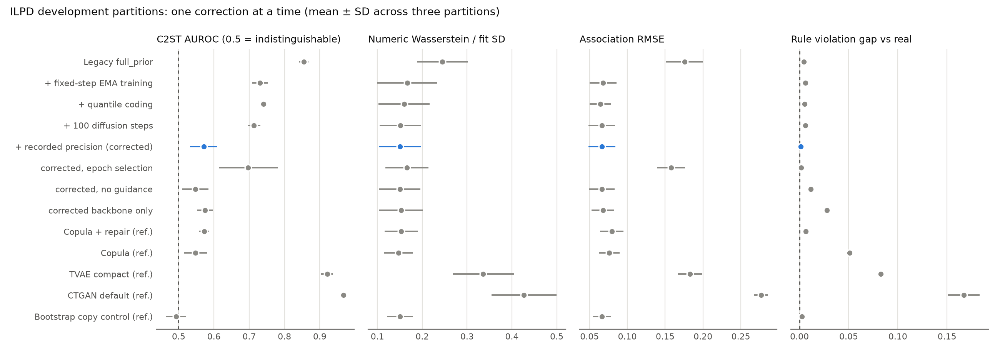
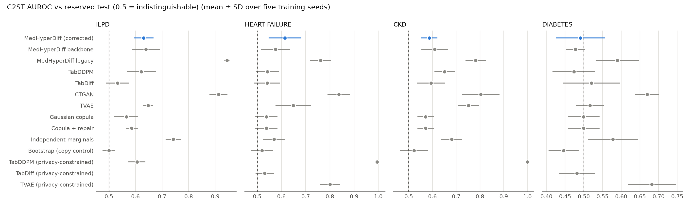

# Constraint-Guided Mixed-Type Diffusion for Small Clinical Tables: Training, Representation and Evaluation Pitfalls, and What Remains After Correcting Them

**Research manuscript draft, 6 October 2026. Not yet submitted.** Authors, affiliations, venue and declarations are to be supplied by the researchers. Every number below is regenerated from saved run records by `scripts/report_iteration11.py`; development and confirmatory evidence are labelled separately. The previous working draft is preserved in `paper/archive/manuscript_before_iteration11.md`.

## Abstract

Synthetic data are increasingly proposed for sharing small clinical tables, whose heavy-tailed laboratory values, fixed measurement resolutions, missing measurements and approximate biochemical relations stress generic generators. We audit MedHyperDiff, a mixed-type Gaussian/absorbing-mask diffusion model with an empirical feature-association attention bias, nonlinear hyperedge message passing over supplied clinical relations and confidence-weighted physical-unit constraint guidance. Five defects had concealed its behaviour: checkpoint selection by a noisy validation diffusion loss, which kept models from the first 3–28 epochs in 13 of 36 fits and truncated the other 23 at the epoch cap; affine scaling of heavy-tailed laboratory values; continuous decoding of fixed-resolution measurements; scoring of an empirical 95% residual envelope as if fewer violations were better, although 6–9% of real records violate it; and a TabDDPM baseline trained without its upstream recipe. We correct each (fixed-budget EMA training, bounded differentiable quantile coding, recorded-precision decoding, rule-realism metrics and upstream baseline recipes), quantify each correction on development partitions, and then run an equal-budget tuned comparison with TabDDPM, TabDiff, CTGAN, TVAE and statistical references, frozen before a single evaluation on the reserved test folds of four public cohorts with five seeds. Correction reduces MedHyperDiff's classifier two-sample AUROC on the reserved test sets from 0.944 to 0.631 (ILPD), 0.761 to 0.615 (heart failure) and 0.782 to 0.586 (CKD), and ILPD association error from 0.199 to 0.081. It is the only generator that reproduces the real behaviour of the supplied ILPD relations without post-hoc repair (violation-rate gap 0.002; protein-residual Wasserstein distance 0.062 versus 0.104 for TabDiff and 0.145 for repaired copula), and in a controlled simulator matched hypergraph structure preserves a supplied XOR parity better than a parameter-matched dense control (0.9% versus 3.5% violations). However, TabDiff and, on most cohorts, a Gaussian copula achieve lower two-sample AUROC, utility differences are within patient-bootstrap uncertainty, and all diffusion models memorize the diabetes cohort. The results support a scoped contribution — faithful reproduction of supplied clinical relations, and a set of evaluation corrections that change model rankings — rather than general superiority.

## 1. Introduction

A synthetic clinical table is useful only if it reproduces the joint behaviour of real measurements, retains predictive signal, respects known clinical relationships to the degree real data do, and does not copy patients. Small public cohorts are where these requirements collide: a few hundred records, laboratory values spanning orders of magnitude, values reported on fixed grids, missing measurements and approximate biochemical identities that real records violate through rounding and assay variation.

This paper began as the development of MedHyperDiff, a constraint-guided diffusion model, and became an audit. Ten development iterations had reported mixed, partition-dependent effects and a repaired Gaussian copula that dominated the model on fidelity. We show that these conclusions were largely produced by training, representation and evaluation defects rather than by the model's structure, correct them, and test what remains under a frozen protocol against strong current baselines. Our contributions are:

1. **Diagnosis of five defects** that are easy to make in small-table synthesis studies, each with direct evidence from saved runs, and a one-correction-at-a-time ablation quantifying their effects (§5.1).
2. **A corrected constraint-guided diffusion model** whose supplied nonlinear hyperedge structure, physical-unit energy and calibrated guidance reproduce real rule behaviour in a controlled simulator and on ILPD (§5.2–5.3).
3. **A frozen, equal-budget comparison** with TabDDPM and TabDiff trained by their upstream recipes, CTGAN, TVAE and statistical references on four cohorts, including a privacy-constrained selection that exposes memorization rewarded by two-sample tests (§5.3–5.4).

## 2. Related work

CTGAN and TVAE introduced conditional GAN and VAE generators for mixed tables. TabDDPM ([Kotelnikov et al., ICML 2023](https://proceedings.mlr.press/v202/kotelnikov23a.html)) combined Gaussian and multinomial diffusion; TabDiff ([Shi et al., ICLR 2025](https://arxiv.org/abs/2410.20626)) uses continuous-time joint diffusion with learnable per-column schedules. Feature-relational generation appears in GOGGLE; constrained generation in C-DGM and DRL; adaptive structural regularization in CausalDiffTab; and inference-time mixed-tabular guidance in Harpoon. Velocity parameterization and EMA weights are standard diffusion practice (Salimans and Ho, 2022). The verified source ledger is in `docs/RESEARCH_REVIEW.md`. We claim no novelty for graphs, constraints, guidance, quantile coding, EMA or velocity prediction individually; the contribution is the tested combination for supplied clinical relations and the corrected evaluation.

## 3. Method

### 3.1 Representation

A record contains numerical measurements, categorical values, a binary observation indicator for every numerical feature and a binary class label. All learned preprocessing uses the fit partition only. Missing numerical values are replaced by the fit median as an internal placeholder; their observation indicators are generated jointly with the values and restore missingness after decoding. Categorical levels absent from the fit partition, the missing state and the unknown state are excluded from generation.

**Quantile coding.** Each numerical feature is mapped through mid-rank empirical normal scores of its observed fit values: for sorted distinct values `v_1 < … < v_m` with counts `c_k`, the knot `v_k` receives `z_k = Φ⁻¹((C_{k−1} + c_k/2)/n)`. Encoding interpolates linearly between knots; decoding interpolates the inverse map and is clamped to `[v_1, v_m]`. The inverse is therefore bounded by the fitted support (an explicit bounded-support choice; the unbounded asinh decoding tested in iteration 8 produced bilirubin values near 8×10¹⁹) and piecewise linear, so physical-unit rule energies remain differentiable with respect to the generator's coordinates. The original affine coding remains available and reproduces archived runs exactly.

**Recorded-precision decoding.** Clinical measurements are reported on fixed grids (bilirubin 0.1 mg/dL, enzymes 1 U/L, A/G ratio 0.01). For each numerical feature we detect the smallest number of decimals reproducing every fit value up to floating-point error and round decoded values to it; features without such a grid are left continuous. In the comparison the same decoding is applied to every continuous-output generator, and is a no-op for the statistical references, which already emit observed values.

### 3.2 Denoiser

Numerical values become tokens through learned scalar embeddings; categorical values, observation indicators and an absorbing mask state use embedding tables. Feature identities, a sinusoidal time embedding and a label embedding condition a small transformer. A fit-only, bootstrap-stable association graph (absolute Spearman correlation for numerical pairs, binned normalized mutual information otherwise) adds a learned-strength attention bias. For each supplied multi-feature rule, a nonlinear hyperedge block transforms incident feature tokens, mean-aggregates them to an edge state with a learned edge identity, applies a nonlinear edge update and returns messages to the incident features; features in no rule receive no hypergraph residual. A dense-incidence control keeps the same edge slots and parameters but connects every feature to every edge.

### 3.3 Mixed diffusion

Numerical coordinates follow a cosine-schedule Gaussian diffusion and the denoiser predicts the velocity `v_t = √ᾱ_t ε − √(1−ᾱ_t) x_0`; categorical tokens follow an absorbing-mask process that masks with probability `t/T` and is trained with the `T/t`-weighted masked cross-entropy. Reverse sampling uses the Gaussian posterior with the reconstructed clean prediction (no noise at the final step) and reveals each masked token with probability `1/t`.

### 3.4 Clinical rules, energy and guidance

Each rule stores operands, relation, tolerance, scale, fixed confidence weight, provenance and review status. For ILPD the supplied rules are nonnegativity of each laboratory value, albumin ≤ total protein, direct ≤ total bilirubin (+0.1 mg/dL) and the protein identity `|AG·(TP − ALB) − ALB| ≤ δ`, with `δ` the fit-partition 95th percentile of residuals (a descriptive envelope, not a clinical acceptance threshold). Residuals are computed in source units through the preprocessor's differentiable decoder. The energy is the confidence-weighted smooth-L1 penalty on positive normalized excess residuals, multiplied by observation eligibility and divided by the total rule weight. Training adds this energy with coefficient λ and a late-noise emphasis; sampling takes a bounded per-row gradient step on clean numerical predictions and categorical logits, with a schedule increasing toward the end of reverse diffusion. Observation probabilities are detached, so guidance cannot reduce energy by hiding measurements. Guidance strength is calibrated so that synthetic violation rates match those of real held-out records rather than minimized (§4.4).

### 3.5 Training

The model trains for a fixed number of optimizer steps with AdamW, a learning rate decaying linearly to zero and an exponential moving average (decay 0.999) of the weights; the averaged weights are used for sampling. A fixed-noise validation loss is logged with a separate random generator for monitoring only; it never selects a checkpoint, and training is bitwise identical with or without validation records. Observation heads start at fit frequencies (iteration 5). Training randomness is seeded independently of architecture size so that ablations share corruption noise.

## 4. Experimental protocol

### 4.1 Data and isolation

Four public UCI cohorts are used: ILPD (583 records; nine laboratory/demographic values and sex), heart failure (299; follow-up time excluded), CKD (400; 1,012 missing cells) and early-stage diabetes risk (520; 251 distinct predictor profiles). Identical predictor profiles are grouped; five stratified group outer folds use split seed 2026 and outer fold 0 is the reserved test set for every cohort. Development uses three inner fit/validation partitions of the remaining records (inner seeds 2027, 3027, 4027). A controlled simulator (512 records; protein algebra and an XOR symptom parity) tests mechanism only. Dataset audits, checksums and licences are in `reports/DATA_AUDIT.md`.

### 4.2 Stages

The protocol (`docs/ITERATION_11_PROTOCOL.md`) was written before any search, calibration or test result, with two dated amendments made before the relevant results existed (adding TabDiff; adding a privacy-constrained secondary selection). (A) A correction ablation on ILPD development partitions applies one change at a time to the previous best recipe (three partitions × three seeds). (B) A controlled simulator compares legacy and corrected full, dense-incidence, unguided and backbone variants. (C) Every neural generator — MedHyperDiff, TabDDPM, TabDiff, CTGAN, TVAE — receives eight configurations (its recommended default plus seven seeded random draws from a predeclared space; TabDDPM's space reproduces upstream `tune_ddpm.py`) on each cohort's three development partitions, and the configuration with the best mean rank of C2ST, numerical Wasserstein distance and forest TSTR AUROC is selected; a secondary selection repeats this among configurations with nearest-synthetic membership AUROC ≤ 0.60. (D) MedHyperDiff guidance is calibrated on development partitions to minimize the gap between synthetic and real rule-violation rates. (E) After freezing selections and guidance (hashed into every confirmation manifest), each method is fitted on the full development pool with five seeds and evaluated once on the reserved test fold.

### 4.3 Comparators and budgets

TabDDPM and TabDiff use pinned, unmodified upstream model code with their upstream training loops; CTGAN and TVAE use `ctgan==0.11.1` per class; statistical references are a Gaussian copula, the copula with explicit rule repair, independent class-conditional marginals and bootstrap resampling as a copy control. All continuous-output generators decode to recorded precision. The legacy MedHyperDiff recipe is included as the previous best internal model, and a MedHyperDiff backbone without graph, hyperedges, energy or guidance isolates the clinical structure.

### 4.4 Endpoints

Primary endpoints are C2ST AUROC of a balanced random-forest discriminator against the reserved test records (0.5 indicates indistinguishable) and forest TSTR AUROC on the reserved test records. Secondary endpoints are numerical Wasserstein distance scaled by fit SD, association RMSE, signed Spearman RMSE, logistic utility, rule realism (mean absolute gap between synthetic and real per-rule violation rates; Wasserstein distance between synthetic and real residuals of relational rules; pooled hard-rule violations) and empirical privacy (nearest-synthetic membership AUROC with equal-size member and non-member sets; exact predictor copies; distance to closest record). We report means and SDs over five training seeds, seed-paired differences and, for utility, 95% intervals from 2,000 paired bootstraps of test patients with seed-averaged predictions. These intervals are conditional on the fitted generators. The predeclared superiority criterion required lower C2ST than every non-memorizing comparator on at least three of four cohorts.

## 5. Results

### 5.1 The defects and their effects (development)

In the previous protocol, 13 of 36 iteration-5 fits stopped during the initial validation-loss plateau and kept checkpoints from epochs 3–28; the other 23 reached the 100-epoch cap, selecting epochs 86–100 with validation loss still falling. Table 1 applies the corrections cumulatively.

**Table 1. ILPD development partitions (mean of three partition means; three seeds each).**

| Variant | C2ST | Numeric W | Association RMSE | Violation gap | Protein-residual W1 | Membership AUROC |
|---|---:|---:|---:|---:|---:|---:|
| Legacy full_prior | 0.855 | 0.245 | 0.176 | 0.004 | 0.100 | 0.503 |
| + fixed-step EMA training | 0.730 | 0.167 | 0.068 | 0.006 | 0.117 | 0.522 |
| + quantile coding, 100 steps | 0.714 | 0.151 | 0.066 | 0.006 | 0.116 | 0.527 |
| + recorded precision (corrected) | **0.571** | **0.150** | **0.066** | **0.001** | 0.115 | 0.527 |
| corrected, but epoch selection | 0.697 | 0.166 | 0.158 | 0.002 | 0.117 | 0.513 |
| corrected, no guidance | 0.547 | 0.150 | 0.066 | 0.012 | 0.141 | 0.527 |
| corrected backbone only | 0.575 | 0.153 | 0.068 | 0.028 | 0.227 | 0.530 |
| Copula + repair (re-scored) | 0.573 | 0.153 | 0.079 | 0.006 | 0.212 | 0.525 |
| Bootstrap copy control | 0.493 | 0.150 | 0.066 | 0.002 | 0.082 | 0.997 |

Training correction alone reduces association error by 61%, to the level of the copy control; reinstating epoch selection on top of all other corrections undoes most of it. Recorded-precision decoding accounts for most of the remaining C2ST gain. The rule machinery is what makes the protein and bilirubin relations realistic: without it the backbone violates at least one supplied rule in 40% of rows, against about 8% of real validation records.

### 5.2 Supplied higher-order structure in a controlled simulator (development)

| Arm | XOR parity violation (real 0%) | C2ST | Numeric W |
|---|---:|---:|---:|
| Legacy full / legacy dense | 33.8% / 36.3% | 1.000 / 1.000 | 7.79 / 7.89 |
| Corrected backbone | 6.4% | 0.537 | 0.102 |
| Corrected dense incidence (equal parameters) | 3.5% | 0.957 | 0.642 |
| Corrected full | 0.9% | 0.949 | 0.638 |
| Corrected full, no guidance | 0.9% | 0.541 | 0.106 |

Matched hyperedge structure reduces parity violations fourfold relative to the parameter-matched dense control and sevenfold relative to the backbone, consistently across partitions (0.9–1.0%). The effect comes from structure and energy training: unguided, the full model keeps 0.9% parity violation at backbone-level fidelity. Guidance strength 10, chosen on ILPD in earlier iterations, destroys simulator fidelity because its protein identity is exact with a 0.02 tolerance; guidance must be calibrated per dataset, which the confirmation does.

### 5.3 Frozen confirmation on the reserved test sets

**Table 2. Reserved outer test fold 0; mean ± SD over five training seeds. Membership AUROC near 1 indicates copying.**

| Cohort | Method | C2ST | Numeric W | Association | Forest TSTR | Violation gap | Membership |
|---|---|---:|---:|---:|---:|---:|---:|
| ILPD | MedHyperDiff (corrected) | 0.631 ± 0.037 | 0.120 | 0.081 | 0.730 | **0.002** | 0.518 |
| | MedHyperDiff legacy | 0.944 ± 0.011 | 0.360 | 0.199 | 0.755 | 0.003 | 0.489 |
| | MedHyperDiff backbone | 0.639 ± 0.052 | 0.120 | 0.085 | 0.728 | 0.039 | 0.505 |
| | TabDiff | **0.533 ± 0.043** | **0.114** | 0.078 | 0.730 | 0.013 | 0.524 |
| | TabDDPM | 0.621 ± 0.055 | 0.166 | 0.078 | 0.711 | 0.013 | 0.633 |
| | Gaussian copula | 0.566 ± 0.045 | 0.120 | **0.063** | 0.726 | 0.053 | 0.536 |
| | Copula + repair | 0.586 ± 0.023 | 0.125 | 0.063 | 0.723 | 0.004 | 0.530 |
| | TVAE / CTGAN | 0.647 / 0.912 | 0.148 / 0.354 | 0.095 / 0.195 | 0.697 / 0.736 | 0.054 / 0.142 | 0.511 / 0.514 |
| Heart failure | MedHyperDiff (corrected) | 0.615 ± 0.068 | 0.193 | 0.083 | 0.768 | 0 | 0.599 |
| | MedHyperDiff legacy | 0.761 ± 0.043 | 0.273 | 0.082 | 0.772 | 0 | 0.506 |
| | TabDiff (privacy-constrained) | **0.531 ± 0.038** | 0.181 | 0.075 | 0.772 | 0 | 0.626 |
| | TabDDPM | 0.542 ± 0.047 | 0.245 | **0.064** | 0.759 | 0 | **0.990** |
| | Gaussian copula | 0.538 ± 0.046 | 0.183 | 0.070 | 0.752 | 0 | 0.579 |
| CKD | MedHyperDiff (corrected) | 0.586 ± 0.035 | **0.141** | **0.086** | 1.000 | 0 | 0.528 |
| | MedHyperDiff legacy | 0.782 ± 0.043 | 0.196 | 0.132 | 1.000 | 0 | 0.502 |
| | TabDiff | 0.594 ± 0.060 | 0.175 | 0.090 | 1.000 | 0 | 0.720 |
| | TabDDPM | 0.651 ± 0.043 | 0.818 | 0.123 | 1.000 | 0 | **0.906** |
| | Gaussian copula | **0.571 ± 0.034** | 0.154 | 0.095 | 1.000 | 0 | 0.503 |
| Diabetes | MedHyperDiff (corrected) | 0.491 ± 0.065 | 0.191 | 0.106 | 0.973 | 0 | **0.894** |
| | MedHyperDiff legacy | 0.590 ± 0.058 | 0.232 | 0.122 | 0.980 | 0 | 0.489 |
| | TabDiff (privacy-constrained) | 0.481 ± 0.048 | 0.149 | 0.110 | 0.982 | 0 | 0.575 |
| | TabDDPM | 0.474 ± 0.057 | 0.181 | 0.104 | 0.979 | 0 | **0.932** |
| | Gaussian copula | 0.500 ± 0.043 | 0.165 | 0.114 | 0.984 | 0 | 0.590 |

Real-data TRTR forest AUROC is 0.720 (ILPD), 0.752 (heart failure), 1.000 (CKD) and 0.981 (diabetes). Complete tables, including every arm and secondary metric, are in `reports/iteration11/RESULTS.md`.

**Overall realism.** Correction reduces MedHyperDiff's C2ST against reserved patients by 0.31 (ILPD), 0.15 (heart failure), 0.20 (CKD) and 0.10 (diabetes), better in every seed of every cohort. Against external methods it is not the best: TabDiff is lower on ILPD (by 0.098, all five seeds) and heart failure, and the copula is lower on ILPD, heart failure and CKD. On CKD, MedHyperDiff and its backbone have the lowest numerical and association error of the non-copying generators and C2ST within seed noise of TabDiff and the copula. The predeclared superiority criterion is met on none of the four cohorts.

**Clinical relations.** On ILPD, MedHyperDiff reproduces real rule behaviour best: violation-rate gap 0.002 (better than TabDiff and TabDDPM in all five seeds), zero hard-rule violations and a protein-residual Wasserstein distance to real test records of 0.062, against 0.104 for TabDiff, 0.115 for TabDDPM, 0.145 for the repaired copula, 0.272 for its own backbone and 0.044 for exact copies. Repair achieves a low violation gap only by rewriting 98% of rows to satisfy the identity, which moves the residual distribution away from real data. The other cohorts supply only unary rules, which bounded quantile decoding satisfies automatically; they do not test this contribution.

**Utility.** Forest TSTR AUROC is within patient-bootstrap uncertainty of every strong comparator (for example ILPD versus TabDiff +0.002, 95% interval −0.035 to 0.044; heart failure versus TabDiff −0.012, −0.071 to 0.042) and close to real-data TRTR. We find no utility advantage.

### 5.4 Privacy and memorization

Two-sample tests reward copying. Selected TabDDPM configurations reached membership AUROC 0.990 (heart failure), 0.906 (CKD) and 0.932 (diabetes; 83% exact predictor copies). Privacy-constrained TabDDPM alternatives diverged numerically on heart failure and CKD (C2ST 0.995 and 1.000), consistent with the upstream epsilon-prediction sampler's sensitivity on small tables. On diabetes, which has 251 distinct profiles of 15 binary symptoms plus age, every diffusion model memorized, including MedHyperDiff (0.894; 35.5% exact copies), and no MedHyperDiff configuration in the search stayed below 0.60. On ILPD, heart failure and CKD MedHyperDiff's membership AUROC was 0.518, 0.599 and 0.528. These are diagnostic attacks; no formal privacy guarantee is claimed.

## 6. Discussion

The central lesson is methodological. A noisy validation diffusion loss is a poor checkpoint criterion on a few hundred records: patience-based stopping returned untrained models or truncated ones, and every architectural comparison built on it was confounded. Affine scaling and continuous decoding of fixed-resolution measurements each produced detectable artefacts, and scoring an empirical envelope as "zero violations is best" rewarded over-correction. A baseline trained outside its upstream recipe looked unstable for the same reason our own model did. Correcting these issues changed the ordering of every model pair studied in ten earlier iterations, and turned the previously dominant repaired copula into one strong reference among several.

After correction, the clinical structure has a specific and measurable role. It does not make the generator more realistic overall — TabDiff's learnable schedules and the copula's empirical marginals are better at that on these cohorts — but it makes supplied relations behave like they do in real records, in a simulator with a known parity and on the ILPD protein and bilirubin relations, without repairing outputs. Whether that is worth a C2ST cost of roughly 0.05–0.10 against TabDiff depends on the use: for analyses that depend on laboratory identities or derived quantities it may be; for general-purpose release it is not demonstrated. A natural next step is to add MedHyperDiff's hyperedge energy and calibrated guidance to a TabDiff-style backbone.

The privacy results argue for reporting memorization next to any two-sample or fidelity metric, and for privacy-aware model selection: on small tables the most "realistic" configuration is often the one that copies.

## 7. Limitations

Each cohort contributes one reserved outer fold of 60–117 patients, so C2ST is noisy (seed SD up to 0.07) and no cross-cohort significance test is justified. Hyperparameters were selected on overlapping inner partitions; MedHyperDiff additionally received a sampling-only guidance calibration, and its corrected default was developed on one ILPD partition before the protocol. The supplied ILPD rules are unreviewed by clinicians or laboratory specialists, and three cohorts provide only unary rules. TabDDPM and TabDiff are documented adaptations of upstream code (joint label column for TabDiff; quantile coding with explicit missingness flags for both), not reproductions of their published benchmarks. Privacy evaluation uses a nearest-distance membership attack and copy counts only; there is no differential privacy, and the diabetes outputs of every diffusion model should be treated as memorized. CPU timings were measured under variable background load.

## 8. Reproducibility

Splits, fit-only preprocessing, rule registries, graphs, configurations, MedHyperDiff checkpoints, synthetic tables, downstream predictions, metrics and hashed manifests are saved for all 861 iteration-11 jobs (72 ablation, 54 simulator, 480 search, 255 confirmation), with source snapshots `9739e858…` (ablation and four-method search) and `721c3bbb…` (adds only the TabDiff adapter). The corrected core reproduces the archived iteration-5 synthetic table byte-for-byte under legacy settings, a guidance-stage refit reproduces its search counterpart exactly, and 48 tests pass. Commands are in `docs/ITERATION_11_RUNBOOK.md`; earlier iterations remain reproducible from their snapshots.

## Declarations — researcher input required before submission

Authorship and contributions, funding, competing interests, dataset licences and acknowledgements, institutional ethics determination for public de-identified data, code and data availability, and venue-required disclosure of AI assistance must be supplied by the researchers. Do not invent approvals or authors.
