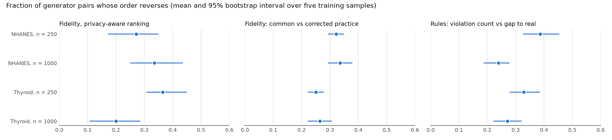
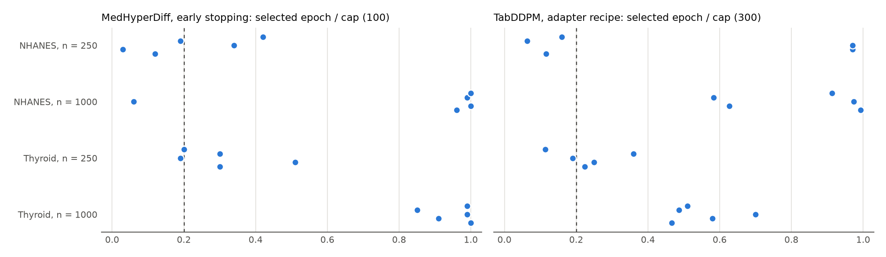
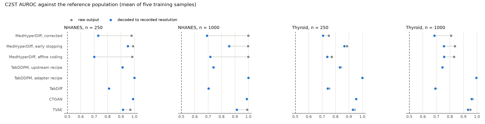
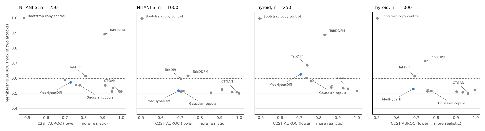
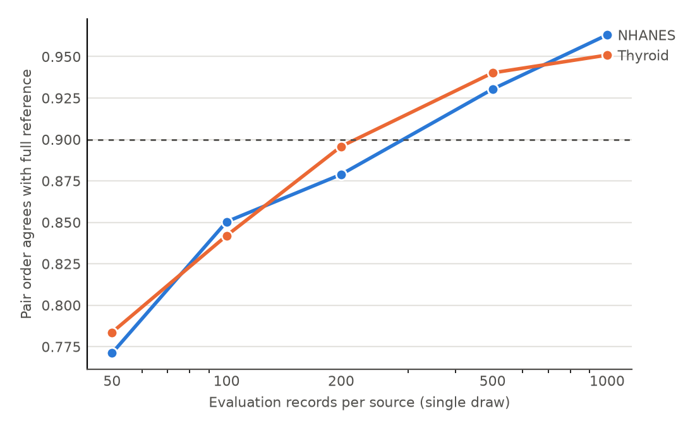
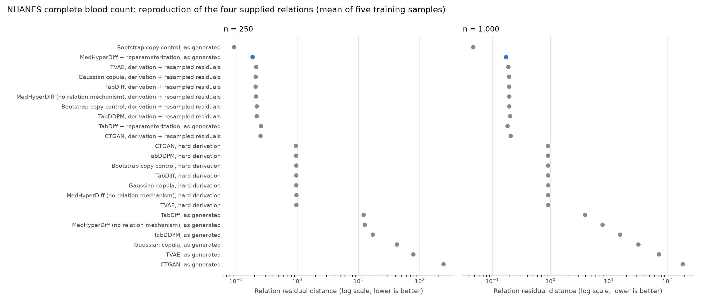

# Seven Pitfalls in Training and Evaluating Synthetic Clinical Table Generators: A Case Study and a Controlled Study

**Methods manuscript draft, October 2026. Not yet submitted.** Authors, affiliations, venue and declarations are to be supplied by the researchers. All numbers are regenerated from saved run records by `scripts/report_iteration11.py` (case study) and `scripts/report_iteration12.py` (controlled study).

## Abstract

**Background.** Synthetic clinical tables are judged by empirical evaluation, yet the small size, heavy-tailed laboratory values, fixed reporting resolutions and derived variables of clinical data interact with routine training and evaluation choices.
**Methods.** We describe seven pitfalls found while developing a constraint-guided diffusion model: checkpoint selection by a noisy validation loss, affine scaling of skewed laboratory values, ignoring recorded measurement resolution, scoring rules by violation counts, baselines trained outside their upstream recipes, fidelity metrics that reward memorization, and small evaluation sets. We report their consequences in the development case study and quantify them in a pre-registered controlled study on two public populations (NHANES 2017–2018, 4,756 adults; UCI thyroid, 9,172 records) with definitional and approximate laboratory relations, using twelve generator variants, two training sizes (250 and 1,000) and five independent training samples each, evaluated against large never-fitted reference sets.
**Results.** Moving from common to corrected practice reversed the order of 25–34% of generator pairs (Kendall τ 0.33–0.50) and changed the top-ranked generator in 18 of 20 training samples. Validation-loss early stopping returned checkpoints from the first 20 epochs in 30% of fits and worsened two-sample AUROC in all 20 paired samples (by up to 0.22); a non-upstream TabDDPM loop diverged. Decoding to recorded resolution changed two-sample AUROC by up to 0.31 for some generators and not at all for others, because inverse-transform details decide whether raw outputs fall on the reporting grid; alone it reversed up to 32% of pairwise rankings. Learned generators violated definitional identities in 90–100% of rows. Lower two-sample AUROC went with higher membership-inference AUROC (Spearman −0.33 to −0.77), and in up to 80% of training samples at n = 250 the most realistic non-copying generator exceeded 0.60. A single two-sample test on 100 records per source ordered generator pairs correctly only 84–85% of the time; 90% required about 500.
Applying the corrected protocol to a new population of 4,865 blood counts, MedHyperDiff with relation reparameterization reproduced four supplied laboratory relations better than every published generator, with or without exact constraint enforcement, in all ten confirmation samples. At 250 training records it was also more realistic (two-sample AUROC 0.691 vs 0.736 for TabDiff with derivation) and more useful (0.717 vs 0.671) without memorizing; at 1,000 records TabDiff was more realistic.
**Conclusions.** Routine choices can determine which synthetic-data generator appears best, and correcting them enables measurable improvements. We give a seven-item corrected protocol, an open implementation and run records sufficient to reproduce every number.

## 1. Introduction

Synthetic data are proposed as a way to share clinical tables without sharing patients. Whether a synthetic table is useful, faithful and safe is judged almost entirely by empirical evaluation: two-sample classifier tests, marginal and dependence distances, train-on-synthetic-test-on-real utility, constraint or rule checks, and distance- or attack-based privacy diagnostics. Clinical tables are typically small, their laboratory values are heavy-tailed and recorded on fixed reporting grids, they contain missing measurements, and some of their variables are related by definitions (derived quantities) or approximate biochemical identities. These properties interact with common training and evaluation choices in ways that are easy to miss and that can change which generator appears best.

This paper documents seven such pitfalls. They were found while developing a constraint-guided diffusion model, MedHyperDiff, where ten development iterations produced mixed, partition-dependent conclusions and a repaired Gaussian copula appeared to dominate the model. Correcting the pitfalls reversed most of those conclusions (Section 4). We then test whether the pitfalls generalize, in a pre-registered controlled study on two public populations with definitional and approximate relations, twelve generator variants, two training-set sizes and five independent training samples per size, evaluated against large held-out reference sets (Sections 5–6), and give a corrected protocol (Section 7).

**Contributions.** (1) A catalogue of seven pitfalls with their mechanisms and symptoms (Section 3). (2) A case study showing their combined consequences in a real development project, including a frozen confirmation on reserved test folds (Section 4). (3) A controlled study quantifying each pitfall's effect on measured quality, privacy and, most importantly, on the ranking of generators (Section 6). (4) A corrected protocol and an open implementation with tests, hashed run manifests and reproducible reports (Sections 7 and 11). (5) A demonstration that the protocol yields better generators: relation reparameterization lets MedHyperDiff reproduce approximate clinical relations better than published generators, and in small samples also be the most realistic and useful non-copying generator (Section 8).

## 2. Related work

Tabular generators range from statistical copulas to GANs and VAEs (CTGAN, TVAE) and diffusion models (TabDDPM, [Kotelnikov et al., ICML 2023](https://proceedings.mlr.press/v202/kotelnikov23a.html); TabDiff, [Shi et al., ICLR 2025](https://arxiv.org/abs/2410.20626)). Constraint-aware generation includes C-DGM ([Stoian et al., 2024](https://arxiv.org/abs/2402.04823)), DRL ([Stoian and Giunchiglia, 2025](https://arxiv.org/abs/2502.18237)) and inference-time guidance such as Harpoon ([Shankar et al., ICLR 2026](https://openreview.net/pdf?id=G5g6tDg1ZE)). Evaluation commonly combines classifier two-sample tests ([Lopez-Paz and Oquab, ICLR 2017](https://arxiv.org/abs/1610.06545)), marginal and dependence distances, downstream utility, and privacy diagnostics such as distance to closest record, membership inference by overfitting detection (DOMIAS; [van Breugel et al., AISTATS 2023](https://arxiv.org/abs/2302.12580)) and attack-based audits ([Anonymeter](https://arxiv.org/abs/2211.10459)). Variance in cross-validated comparisons is discussed by [Bengio and Grandvalet (JMLR 2004)](https://www.jmlr.org/papers/v5/grandvalet04a.html). We do not propose a new metric family; we show how ordinary choices around these metrics change conclusions on small clinical tables.

## 3. The seven pitfalls

**P1. Checkpoint selection by a noisy validation diffusion loss.** Diffusion losses are averages over random noise levels and masks; on a few hundred records the validation estimate is noisy and often flat early in training. Patience-based early stopping then returns either a model from the initial plateau or a model truncated at the epoch cap. *Symptom:* selected epochs cluster near zero or at the cap; ablation results flip across seeds. *Correction:* a fixed optimization budget with learning-rate decay and weight averaging, chosen in development and never by the evaluation partition.

**P2. Affine scaling of heavy-tailed laboratory values.** Standardization leaves most of the mass of an enzyme or triglyceride distribution in a tiny region of the scaled axis while rare extreme values dominate the loss. *Symptom:* inflated central spread with deficient tails. *Correction:* a rank-based (quantile) representation fitted on training rows, with a bounded inverse when unbounded decoding produces impossible tails.

**P3. Ignoring the recorded measurement resolution.** Laboratories report on fixed grids, sometimes magnitude-dependent (significant figures). Continuous outputs fall off-grid and are detectable by tree-based discriminators, while resampling-based references (bootstrap, copulas that emit observed values) are implicitly advantaged. *Correction:* decode every continuous-output generator to the resolution detected on training rows, per order of magnitude when reporting is significant-figure based.

**P4. Scoring rules by violation counts.** For a definitional relation (a derived variable such as globulin = total protein − albumin) the real violation rate is zero, and re-deriving the variable is correct practice. For an empirical envelope (a tolerance set at a training quantile) a fixed fraction of real records violates by construction, so zero violations signals over-correction. *Correction:* compare synthetic rule behaviour with real held-out behaviour (violation-rate gap and residual-distribution distance) and report hard rules separately.

**P5. Baselines trained outside their upstream recipe.** Adapters that change optimization (constant learning rate, early stopping, clipping) can make a strong method look unstable. *Correction:* reproduce the upstream training loop and document every adaptation.

**P6. Fidelity metrics reward memorization.** Copies of training rows are indistinguishable from real data. When generators or configurations are selected by two-sample tests, near-copying wins on small tables. *Correction:* report membership-inference diagnostics alongside every fidelity metric and select under a privacy constraint.

**P7. Small evaluation sets.** Two-sample AUROC estimated on tens to a hundred records per class is noisy; generator orderings at that size disagree with orderings on large reference sets. *Correction:* evaluate on the largest available held-out reference, repeat subsampling, and report uncertainty.

## 4. Case study: the pitfalls inside one development project

MedHyperDiff is a mixed-type diffusion model (Gaussian numerics, absorbing-mask categories, explicit missingness indicators) with a feature-association attention bias, nonlinear hyperedge message passing over supplied clinical relations and a physical-unit rule energy used in training and, optionally, as sampling guidance. Ten development iterations on four public UCI cohorts (ILPD, heart failure, CKD, early-stage diabetes) had produced partition-dependent effects, a frozen reserved test fold per cohort, and a repaired Gaussian copula that dominated the model on fidelity and rule compliance.

**What the audit found.** In iteration 5, 13 of 36 fits stopped during the validation-loss plateau and kept epochs 3–28; the other 23 reached the 100-epoch cap still improving (P1). Enzyme and bilirubin values were affinely scaled (P2); every numerical column had a fixed reporting grid but outputs were continuous (P3); the ILPD protein relation's tolerance was the training 95th percentile, yet compliance was scored as "fewer violations is better" (P4); and the TabDDPM adapter used a constant learning rate with early stopping instead of the upstream recipe (P5).

**Correcting one pitfall at a time (ILPD development partitions; 3 partitions × 3 seeds).**

| Variant | C2ST | Numeric W | Association RMSE | Rule-gap vs real |
|---|---:|---:|---:|---:|
| Original recipe | 0.855 | 0.245 | 0.176 | 0.004 |
| + fixed-budget EMA training (P1) | 0.730 | 0.167 | 0.068 | 0.006 |
| + quantile coding and 100 steps (P2) | 0.714 | 0.151 | 0.066 | 0.006 |
| + recorded-precision decoding (P3) | 0.571 | 0.150 | 0.066 | 0.001 |
| all corrections but original checkpoint selection | 0.697 | 0.166 | 0.158 | 0.002 |
| Repaired copula (previously "best") | 0.573 | 0.153 | 0.079 | 0.006 |
| Bootstrap copy control | 0.493 | 0.150 | 0.066 | 0.002 |

The training correction alone cut association error by 61%, to the level of the copy control; restoring only the original selection undid most of it. Recording-resolution decoding produced most of the remaining two-sample gain. Under the original scoring, the repaired copula's zero violations looked best; against real behaviour it over-corrects (protein-residual distance 0.212 versus 0.115).

**Consequences for the frozen confirmation.** After the corrections, a pre-registered equal-budget comparison with upstream-recipe TabDDPM and TabDiff, CTGAN, TVAE and statistical references was evaluated once on the reserved test folds (five seeds). Corrected MedHyperDiff improved on its original recipe in every seed and cohort (C2ST 0.944 → 0.631 on ILPD, 0.761 → 0.615 heart failure, 0.782 → 0.586 CKD), but TabDiff and the copula were more realistic overall, and the model's distinct advantage was faithful reproduction of supplied clinical relations. Two further pitfalls surfaced only at this stage: the TabDDPM configurations chosen by the fidelity-and-utility selection rule had membership-inference AUROC of 0.91–0.99 on three of four cohorts, and on the diabetes cohort (251 distinct symptom profiles) every diffusion model memorized (P6); and with 60–117 test patients, seed-to-seed C2ST standard deviations reached 0.07 (P7). A development project that had stopped at iteration 10 would have reported the opposite of most of these conclusions.

## 5. Controlled study design

The case study cannot separate the pitfalls from one model's idiosyncrasies or from the noise of small test folds. The controlled study, pre-registered in `docs/ITERATION_12_PROTOCOL.md` before any generator was fitted to the new data, addresses both.

**Populations.** NHANES 2017–2018 adults with a standard biochemistry record (4,756 records; label diagnosed diabetes, 16.6%; 21 numerical and one categorical predictor), in which globulin = total protein − albumin and BMI = weight/height² are definitional (0% real violations), and the UCI thyroid0387 table (9,172 records; label any thyroid diagnosis, 26.2%; 6 numerical and 16 categorical predictors; up to 28% missing), in which FTI ≈ TT4/T4U holds up to rounding and entry errors (training 95th-percentile envelope; about 5% real violations). TSH is reported to roughly two significant figures, which tests magnitude-dependent resolution.

**Sampling.** Each population is split once into a reference half and a pool half (grouped by identical predictor profile, stratified by label). From the pool, training samples of n = 250 and n = 1,000 are drawn five times each; each sample is split 80/20 into fit and validation rows. All generators fit the same fit rows; only early-stopping variants use the validation rows. The reference half (2,378 and 4,588 records) is never fitted and serves for utility, two-sample tests and as the source of non-members and attacker background data.

**Generators.** Twelve variants: corrected MedHyperDiff; the same with original early stopping (P1) or affine coding (P2); TabDDPM with the upstream recipe and with the earlier adapter loop (P5); TabDiff (upstream); CTGAN and TVAE (package defaults, per class); Gaussian copula, copula with re-derivation of supplied relations, independent marginals, and bootstrap resampling as a copy control. Configurations are fixed in advance; none is tuned per size.

**Measurements.** Every continuous-output generator emits raw values, decoded post hoc in three ways from fit rows only: raw, a global grid, and magnitude-banded resolution (primary). For the primary decoding we compute the full evaluator against the reference (fidelity, dependence, utility, rule rates and rule realism, nearest-distance membership attack), C2ST at 50–1,000 records per class with ten subsamples each, and a density-ratio membership attack in the style of DOMIAS. Raw and global decodings receive full-reference C2ST and per-feature distances.

**Analyses (pre-registered).** Effect sizes for P1 and P2 as replicate-paired differences; for P3, P4, P7 and the overall pipeline, the fraction of generator pairs whose order reverses, Kendall's τ and top-1 agreement, with bootstrap intervals over the five training samples; for P6, how often the lowest-C2ST generator memorizes (membership AUROC above 0.60), and the same question on the 160 configurations of the case-study search.

## 6. Results of the controlled study

All 240 jobs completed. Means are over five independent training samples; the evaluation set is the never-fitted reference half of each population (2,378 NHANES and 4,588 thyroid records). Complete tables are in `reports/iteration12/RESULTS.md`.

### 6.1 Overall: common versus corrected practice

We compared generator rankings under a *common-practice* pipeline (diffusion models trained with validation-loss early stopping, the adapter TabDDPM recipe, raw outputs, C2ST on 100 records per source, no privacy check) and the *corrected* pipeline (fixed-budget training, upstream TabDDPM, magnitude-banded decoding, C2ST on the full reference, membership diagnostics). Eight generator identities were ranked in each training sample.

**Table 1. Ranking agreement between pipelines (mean and 95% bootstrap interval over five training samples).**

| Population, n | Pairs reversed | Kendall τ | Top-1 agreement | Top under common practice | Top under corrected practice |
|---|---:|---:|---:|---|---|
| NHANES, 250 | 32% (29–35) | 0.36 | 0/5 | Copula + re-derivation | MedHyperDiff |
| NHANES, 1,000 | 34% (29–38) | 0.33 | 0/5 | Gaussian copula | MedHyperDiff |
| Thyroid, 250 | 25% (22–28) | 0.50 | 0/5 | TabDiff | MedHyperDiff |
| Thyroid, 1,000 | 26% (22–31) | 0.47 | 2/5 | TabDiff | MedHyperDiff |

A quarter to a third of all pairwise comparisons reverse, and the top-ranked generator changes in 18 of 20 training samples. The case-study model ranked 4th–6th of eight under common practice in most samples and first in 16 of 20 under corrected practice. With a privacy-aware ranking that places memorizing generators last, the top generator for thyroid at n = 250 becomes the copula with re-derivation. Scoring rule behaviour by violation counts rather than the gap to real rates reverses 24–39% of pairs but leaves re-derivation on top.

### 6.2 Training: checkpoint selection, baseline recipes and representation

With validation-loss early stopping, 30% of MedHyperDiff fits kept a checkpoint from the first 20 epochs (earliest epoch 3) and 45% stopped at the cap. C2ST was worse than with fixed-budget training on the same fit rows in all 20 paired samples (+0.22 NHANES and +0.16 thyroid at n = 250; +0.17 and +0.07 at n = 1,000), and so was association error. The adapter TabDDPM loop, on the upstream architecture, diverged: C2ST 0.995–1.000 and forest utility 0.49–0.70, against 0.74–0.91 and 0.87–0.94 with the upstream recipe. Quantile coding beat affine coding on C2ST in three of four settings in every sample (−0.02 to −0.07) but lost on NHANES at n = 250 (+0.03), and it helped the most skewed distributions (TSH, GGT) more than others; representation is a choice to validate, not a fixed rule.

### 6.3 Recording resolution

**Table 2. C2ST against the reference by decoding (selected generators, n = 1,000).**

| Generator | NHANES raw | NHANES decoded | Thyroid raw | Thyroid global grid | Thyroid banded |
|---|---:|---:|---:|---:|---:|
| MedHyperDiff (corrected) | 0.999 | 0.692 | 0.808 | 0.763 | 0.685 |
| TVAE | 0.991 | 0.913 | 0.950 | 0.947 | 0.934 |
| TabDiff | 0.703 | 0.703 | 0.698 | 0.696 | 0.692 |
| TabDDPM (upstream) | 0.744 | 0.738 | 0.742 | 0.747 | 0.745 |

Decoding changes some generators by up to 0.31 and others not at all. The difference is not in the models but in their inverse transforms: TabDDPM and TabDiff invert scikit-learn quantile transforms whose tied knots return 45–98% of values exactly on the recording grid, an implicit decoding, whereas MedHyperDiff (interpolation between distinct values), TVAE and CTGAN emit essentially no on-grid values. Without explicit decoding, generator rankings reverse for 29–32% of pairs on NHANES and 7–14% on thyroid, and the top generator changes. On thyroid, where TSH is reported to about two significant figures, a single global grid recovers only part of the effect.

### 6.4 Rules

No learned generator reproduced the supplied relations: 90–100% of their NHANES rows violated the definitional globulin or BMI identities at recorded resolution (real 0%), and most thyroid rows violated the FTI envelope (real about 5%). Re-deriving definitional variables from their operands reproduced real behaviour exactly. In the case study's ILPD envelope relation, where a generator came close to real rates, zero-violation scoring instead rewarded over-correction (Section 4).

### 6.5 Memorization

Lower C2ST went with higher membership-inference AUROC across generators (Spearman −0.33 to −0.77). Excluding the explicit copy control, the most realistic generator in a training sample exceeded AUROC 0.60 on at least one attack in 40%, 0%, 80% and 20% of samples for NHANES n = 250, NHANES n = 1,000, thyroid n = 250 and thyroid n = 1,000; on thyroid at n = 250 this was corrected MedHyperDiff under the density-ratio attack (0.62). Upstream TabDDPM reached 0.85–0.89 at n = 250. In the case-study search over 160 configurations, the lowest-C2ST configuration of a method memorized in 10 of 20 cohort-method cells. The density-ratio attack was generally more sensitive than nearest-distance matching.

### 6.6 Evaluation size

**Table 3. Probability that one C2ST evaluation orders a generator pair as the full reference does.**

| Records per source | 50 | 100 | 200 | 500 | 1,000 |
|---|---:|---:|---:|---:|---:|
| NHANES | 0.77 | 0.85 | 0.88 | 0.93 | 0.96 |
| Thyroid | 0.78 | 0.84 | 0.90 | 0.94 | 0.95 |
| Pairs differing by ≤ 0.02 (both) | 0.58 | 0.59 | 0.58 | 0.65 | 0.71 |
| Median single-draw SD | 0.062 | 0.045 | 0.031 | 0.015 | 0.008 |

At the 60–120 test patients typical of public clinical cohorts, one in six pairwise comparisons is ordered wrongly, and close competitors are separated little better than by a coin flip.

## 7. A corrected protocol

1. **Train with a fixed budget chosen in development**, with learning-rate decay and weight averaging; if validation selection is used, report the selected epochs and test their stability.
2. **Validate the numerical representation** (quantile versus affine at least) and prefer a bounded inverse.
3. **Decode every continuous-output generator to the recorded resolution**, per order of magnitude where reporting is significant-figure based, and report the on-grid fraction of raw outputs.
4. **Re-derive definitional variables; score approximate relations against real held-out behaviour** (violation-rate gap and residual distance), reporting hard rules separately.
5. **Reproduce baselines with their upstream training loops** and document every adaptation.
6. **Report membership inference next to every fidelity metric**, with at least a nearest-distance and a density-ratio attack and a copy control, and select configurations under a privacy constraint.
7. **Evaluate two-sample tests on at least about 500 records per source** where possible, repeat subsampling, report intervals, and treat C2ST differences below 0.02 as unresolved.

## 8. Using the corrected protocol: a generator that reproduces approximate clinical relations

The corrected protocol is also a way to build better generators. One finding of the controlled study was that every learned generator broke the supplied laboratory relations, and the case study showed that exact enforcement over-corrects relations that real data satisfy only approximately. We therefore extended MedHyperDiff with **relation reparameterization**:
- **Generation:** the model generates a basis of variables plus one learned residual per relation.
- **Reconstruction:** each reconstructed variable is recovered as formula + residual, after the basis has been decoded to recorded resolution.
- **Choice of reconstructed variable:** chosen automatically from training rows, so that an acyclic order exists and the reconstructed variables have the largest spread on the relation's additive scale. Reconstructing a narrow quantity from wide ones is ill-conditioned.
- **Structure:** each residual and its operands form a hypergraph edge.

The test followed the corrected protocol (pre-registration in `docs/ITERATION_13_PROTOCOL.md`, with two dated development amendments).
- **Data:** a fresh population, 4,865 NHANES complete blood counts. Haematocrit, MCH and MCHC are analyser-computed from RBC, haemoglobin and MCV, and the white-cell differential sums to 100, all up to reporting rounding.
- **Selection and evaluation:** the variant was chosen on a separate development pool, then fixed and evaluated on a never-fitted reference half of 2,433 records, five training samples per size.
- **Comparators:** published generators, each also with hard derivation (the exact enforcement of constraint-layer methods) and with derivation plus resampled real residuals.

**Table 4. NHANES blood counts, confirmation (mean of five training samples; in parentheses, samples in which MedHyperDiff is better).**

| n | Measure | MedHyperDiff + reparameterization | TabDiff | TabDiff + hard derivation | TabDiff + same reparameterization |
|---|---|---:|---:|---:|---:|
| 250 | Relation residual distance | **0.187** | 12.14 (5/5) | 0.965 (5/5) | 0.257 (5/5) |
| 250 | C2ST | **0.691** | 0.762 (5/5) | 0.736 (5/5) | 0.745 (5/5) |
| 250 | Forest TSTR AUROC | **0.717** | 0.670 (5/5) | 0.671 (5/5) | 0.679 (5/5) |
| 250 | Membership AUROC | 0.555 | 0.619 | 0.618 | 0.598 |
| 1,000 | Relation residual distance | **0.173** | 3.92 (5/5) | 0.911 (5/5) | 0.184 (5/5) |
| 1,000 | C2ST | 0.664 | 0.645 (1/5) | **0.633** (0/5) | 0.643 (0/5) |
| 1,000 | Forest TSTR AUROC | 0.735 | 0.735 (2/5) | 0.733 (2/5) | 0.742 (1/5) |
| 1,000 | Membership AUROC | 0.509 | 0.560 | 0.561 | 0.548 |

**At n = 250 the method is better than every published generator in the comparison in a meaningful area.** It reproduced the four relations best in all five samples against TabDiff, TabDDPM, CTGAN, TVAE and the copula, both as generated (12–244) and with hard derivation (0.95–0.97). Its residual distance (0.187) also beat derivation with resampled real residuals in four of five samples (0.210–0.252). At the same time it was the most realistic non-copying generator (C2ST 0.691 against 0.731 for the best published alternative) and the most useful for prediction (0.717 against at most 0.687 for non-memorizing published alternatives), with membership AUROC 0.555. The pre-registered criteria for the claim were all met.

At n = 1,000 the relation advantage persisted in five of five samples, but TabDiff became more realistic overall (C2ST 0.633 with hard derivation versus 0.664), so the full claim was not supported at that size. The reparameterization is generic, and applied to TabDiff it also repaired relations; the MedHyperDiff version was better on every axis at n = 250. During development, reconstructing the narrow basophil fraction or MCHC instead of a conditioning-based choice raised C2ST to 0.84–0.88, which is why the automatic choice is part of the method.

## 9. Discussion

The seven pitfalls share a property: each changes which generator looks best without any change to the generators' learned distributions. Validation-loss selection and non-upstream baseline loops change what is trained; inverse-transform details decide whether raw outputs fall on the recording grid; zero-violation scoring and two-sample tests reward over-correction and copying; small evaluation sets add enough noise to reorder close competitors. Together they reversed a quarter to a third of all comparisons in a controlled setting and most of the conclusions of a ten-iteration development project.

The case study also shows what remains after correction. A constraint-guided diffusion model that looked dominated became competitive, and on fresh populations with fixed defaults it was often the most realistic non-copying generator; in a tuned comparison on four other cohorts it was not, and TabDiff was. Apart from the pre-registered relation result of Section 8, we draw no conclusion about which generator is best: rankings depend on data, size, configuration and evaluation choices, which is the point. Section 8 shows the constructive side: once evaluation is trustworthy, a targeted mechanism can be shown to help in a precisely stated setting (small samples with known approximate relations) and not in others (TabDiff was more realistic at 1,000 records). Supplied relations are a separate matter: learned generators do not reproduce definitional identities, so they should be re-derived, and approximate relations should be judged against real behaviour.

## 10. Limitations

The controlled study uses two populations (one NHANES cycle without survey weights; one historical thyroid registry), fixed default configurations, two training sizes and five training samples drawn from a common pool, so intervals reflect training-sample variation only. The case study's reserved test folds were small. Membership attacks are empirical diagnostics; the 0.60 threshold is a convention, and no formal privacy guarantee is claimed. MedHyperDiff ran without guidance in the controlled study. The relation result of Section 8 rests on one population and fixed configurations; its development used three disclosed rounds on a separate development pool, and the secondary populations named in its protocol were not run. TabDDPM and TabDiff are adaptations of pinned upstream code (quantile coding with explicit missingness flags; joint label column for TabDiff), not reproductions of their published benchmarks. Computation used CPUs under variable background load.

## 11. Reproducibility

Every job writes split indices, configurations, synthetic tables (raw and decoded), downstream predictions, metrics, histories and a manifest with source, runner, split and data hashes. The controlled study used source snapshot `3aafec1c…`, runner `61a93edf…` and split file `3b60a107…` for all 240 jobs; source files are pinned by SHA-256 (NHANES) or hashed at download (UCI). The case study's iterations are reproducible from their snapshots, and the corrected core reproduces an archived iteration-5 table byte-for-byte under legacy settings. The relation study used source snapshot `36533bf5…` for all 90 confirmation jobs. Fifty-six tests cover the corrections, rule kinds, decodings, attacks and relation reparameterization. Commands are in `docs/ITERATION_11_RUNBOOK.md` and `docs/ITERATION_12_RUNBOOK.md`.

## Declarations — researcher input required before submission

Authorship and contributions, funding, competing interests, dataset terms and acknowledgements (NCHS for NHANES; Garvan Institute and Ross Quinlan for the thyroid data; UCI for the case-study cohorts), ethics determination for public de-identified data, code and data availability, and any venue-required disclosure of AI assistance.
