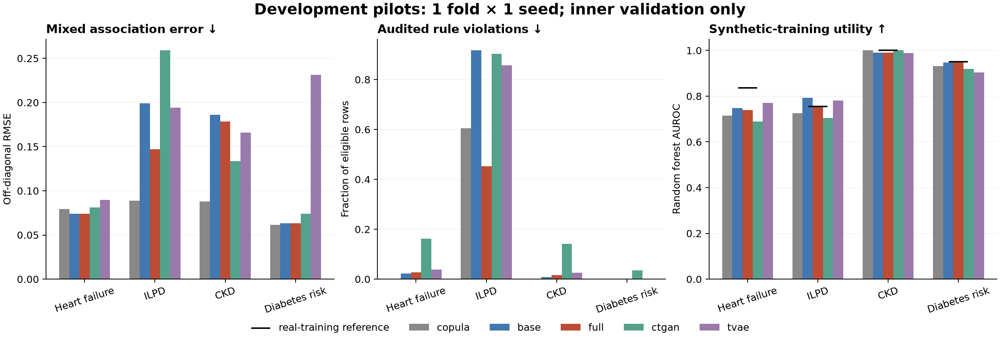

# Interpretation of the clinical development pilots

**The initial experiments do not support a general superiority claim for MedHyperDiff.** They do show that the implemented pipeline works across all four source datasets and that explicit structure can change the trade-off between rule compliance and predictive utility.

The clinical pilot matrix contains 20 completed runs: four datasets and five model families (conditional empirical copula, base diffusion, full MedHyperDiff, CTGAN and TVAE). These runs use one fixed outer fold's inner fit/validation split, one generator seed, 60-epoch budgets for neural models and 30 diffusion steps. They are development comparisons without matched hyperparameter searches. Validation influenced diffusion checkpoint selection. Outer test performance has not been evaluated.

## What the measured pilots show

- On ILPD, the full model reduced the fraction of synthetic rows violating at least one audited rule from **0.917 to 0.453**, and mixed-association RMSE from **0.199 to 0.147**, relative to the base diffusion. Random-forest TSTR AUROC decreased from **0.794 to 0.752**. These are observed point estimates on inner validation, not significant effects or a noninferiority result.
- The ILPD copula achieved lower association error (**0.089**) than the full model, with more rule violations (**0.605**) and TSTR AUROC **0.726**. Thus the full model does not dominate the simple reference on every dimension.
- On Heart Failure, the full model had slightly more audited-rule violations (**0.028 vs 0.022**) and lower TSTR AUROC (**0.739 vs 0.748**) than the base. TVAE reached **0.770** in this pilot. There are no higher-order clinical hyperedges in the registered Heart Failure rules.
- On CKD, the empirical copula had zero audited numerical-bound violations and lower association error than the diffusion arms. Full and base diffusion achieved nearly equal high TSTR AUROC (**0.991 vs 0.990**). These diagnostic-label scores are not prospective clinical validation.
- On diabetes, full and base diffusion both had zero age-bound violations and the same measured TSTR AUROC (**0.946**). The sole registered rule is a nonnegative age bound, so these results provide no evidence about clinical hypergraph effectiveness.

The phrase “audited rule” includes schema bounds and ILPD exploratory biochemical rules. The aggregate is not a clinician-validated medical realism score. Per-rule eligibility, severity and real-data violation rates are stored in every run's `metrics.json`; use them before drawing conclusions about missingness or validity.

A separate ILPD repair control reached zero registered-rule violations with TSTR random-forest AUROC **0.795**, while association RMSE was **0.182** (worse than the full model's **0.147**). This strengthens the case for comparing trade-offs against knowledge-equivalent simple methods; it does not establish a dominant method. The repair's changed-row fraction and uncorrected samples are preserved in `runs/controls/ilpd_repair_f0_s0`.

## Scientific decision

Continue testing the mechanism, but do not write a positive-results paper from this pilot. The strongest immediate research question is whether higher-order factors improve the **validity–fidelity–utility trade-off** beyond energy-only guidance and simple correction on suitable datasets. The broader claim that this architecture is superior across these four small clinical tables is unsupported at present.

Before confirmatory work, prioritize meaningful higher-order clinical constraints/cohorts, official modern diffusion and constraint baselines, parameter-matched controls, wrong-rule sensitivity, broader privacy attacks and a frozen evaluation protocol. Avoid selecting only the favorable ILPD metric; retain the utility loss and the stronger simple-baseline results.

See [the measured run table](pilot/EXPERIMENT_SUMMARY.md), [data audit](DATA_AUDIT.md), [revised protocol](../MedHyperDiff_Research_Proposal_Revised.md) and [implementation status](../docs/IMPLEMENTATION_STATUS.md).

