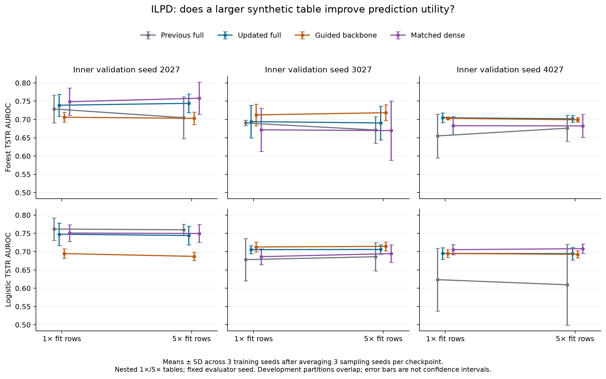

# Iteration 4: larger synthetic tables do not resolve the remaining model failures

We completed **216 new evaluations, using 108 generated pools from 36 previously trained models**. No generator was trained in this stage. The experiment separates sampling seeds from training seeds and fixes evaluator randomness. The original outer test remains untouched. All 216 artifacts passed the provenance, split, exact-prefix, missingness and prediction-score audit; 23 software tests passed.

## What was tested

Four frozen ILPD configurations were crossed with three training seeds, three sampling seeds and three overlapping inner validation partitions. Each pool contains five repetitions of the fit-label vector. We compare its first fit-size rows against the entire pool, with exact class proportions: 349 versus 1,745 rows for inner seeds 2027/3027 and 350 versus 1,750 for 4027. The previous full x0 model, updated full velocity model, same-guidance velocity backbone and parameter-matched dense velocity model receive equal sample budgets.

This asks whether producing more synthetic records improves downstream learning from the existing generator. It does not add real patient information, change model weights or establish the effect of additional real training data. The [frozen protocol](../../docs/ITERATION_4_PROTOCOL.md) predates sampling, and every result is retained in [the full report](RESULTS.md).

## Updated model: small and inconsistent sample-size effects

Values are means over three sampling seeds within each fitted checkpoint, then three training seeds. TSTR means a classifier trained on synthetic rows and evaluated on real inner-validation rows.

| Inner seed | Forest AUROC, 1x → 5x | Logistic AUROC, 1x → 5x | Numerical Wasserstein, 1x → 5x | Supplied-rule violation, 1x → 5x |
|---|---:|---:|---:|---:|
| 2027 | 0.7389 → 0.7441 | 0.7476 → 0.7442 | 0.3044 → 0.3015 | 5.44% → 5.18% |
| 3027 | 0.6941 → 0.6905 | 0.7055 → 0.7060 | 0.2232 → 0.2135 | 4.68% → 5.21% |
| 4027 | 0.7047 → 0.7017 | 0.6951 → 0.6947 | 0.2410 → 0.2324 | 5.75% → 6.08% |

Larger tables modestly improve numerical Wasserstein across all partitions, but do not consistently improve forest or logistic utility. The updated model passes the relative engineering gates on two partitions; the third fails because both utility scores decrease. Three 5x tables also fail the separate feature-wise missingness safeguard. **Do not adopt 5x as the proposed model's default based on these results.** The existing 1x convention is retained for development comparisons, not certified as satisfactory: three updated-model 1x tables also fail that safeguard.

The matched dense comparator passes the declared 5x versus 1x gates in all three partitions without a 5x missingness flag. Its forest changes are +0.0094, −0.0022 and −0.0005, and logistic changes −0.0011, +0.0084 and +0.0026. Thus 5x is a defensible **development recipe for this comparator**, not evidence that it dominates the proposed model. Model rankings still vary by partition; the guided backbone has higher forest utility than the updated full model on partition 3027. The previous full model loses 0.0239 forest AUROC on partition 2027 when using 5x rows. All controls and gate failures are retained in `size_gates.csv` and `size_decision.json`.

## A repeatable missingness failure

For updated full, inner seed 2027, training seed 1, all three 5x pools contain **5.33–5.67% missing A/G ratios**, compared with **0.86%** in the fit partition and zero in inner validation. The corresponding 1x prefixes contain 2.87–5.73% missing values and also exceed the 0.02 fit-error threshold. The failure persists across the three sampling seeds and is not removed by increasing the table size. Its causal mechanism has not been established.

For this arm, partition-2027 mean observed any-rule violation at 5x is 5.18%, but the whole-table violation interval allowing unknown rules to fail is **[5.18%, 7.57%]**. This is a logical missing-data bound, not a confidence interval. Protein-rule coverage averages 97.61%. Missing relations cannot be advertised as compliant. Fit/validation coverage, every rule's bound and each feature's missing rates are saved; no synthetic missing values were filled or silently repaired.

Only the updated model has 5x table-level missingness flags in this study. At 1x, two guided-backbone tables are also flagged. The 0.02 threshold is a declared engineering screen, not a population calibration test or a medically justified tolerance.

## Sampling variance, augmentation and distribution quality

For the updated model, mean within-checkpoint sampling SD of forest AUROC changes from 0.0146 to 0.0117, 0.0171 to 0.0226, and 0.0110 to 0.0090 for the three partitions. Thus even sampling variance does not uniformly improve. Training-seed SD after averaging sampling seeds remains 0.0253, 0.0461 and 0.0095 at 5x; larger tables cannot eliminate variability across fitted models. With only three seeds, these SD estimates are descriptive and imprecise.

Adding updated-model synthetic rows to real fit rows also gives mixed utility. Forest augmentation AUROC at 5x is 0.7431, 0.6984 and 0.7009, versus real-only 0.7473, 0.7098 and 0.7006. Logistic augmentation exceeds real-only on the first two partitions and falls below it on the third. The saved `AUGMENT_5x` label means real fit rows plus five synthetic fit sizes; it is not the earlier evaluator's legacy 1x label.

Updated-model discriminator AUROC remains approximately 0.85–0.88 on partition means, indicating that this audit classifier still distinguishes the generated and real tables. Some numerical variability is compressed: synthetic-to-validation standard deviation ratios reach about 0.27 for ALT/AST in individual evaluations. The tables include these negative diagnostics. No exact predictor copy of a fit row was found in these 216 outputs; this is not a privacy guarantee, and differing synthetic counts change the nearest-distance attack setting.

## Consequences for the paper

The new result strengthens the methodological evaluation: training randomness, sampling randomness and evaluator randomness are no longer conflated, sample counts are compared fairly, and missingness cannot disappear inside a feature average. It provides a measured negative result for the simple “generate more rows” improvement. It does not supply a new superior generator.

Next model changes should target the observation-mask calibration failure and compressed numerical variability, with matched capacity/guidance controls and settings chosen on development data only. Strong external diffusion-baseline reproduction, clinically reviewed rules, incorrect-rule sensitivity, an external cohort and stronger privacy attacks remain necessary. No independent test or clinical validity claim follows from this study.

Vector exports: [PDF](figures/sample_size_utility.pdf) and [SVG](figures/sample_size_utility.svg). [Commands and measured CPU costs](../../docs/ITERATION_4_RUNBOOK.md).
