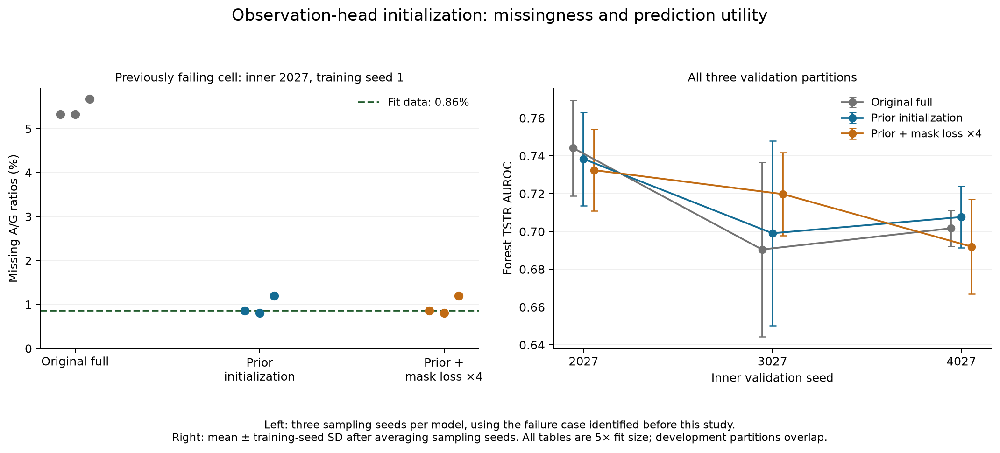

# Iteration 5: training initialization fixes excess missingness but exposes a variance tradeoff

**36 new generator models were trained from scratch.** They produced 108 new five-fit-size synthetic tables, evaluated against 81 matched reference tables from iteration 4. All 189 evaluations use inner validation; the original reserved test remains untouched. The model is implemented and trained, but these results do not establish publication readiness.

## What changed

The first intervention initializes variable observation-head weights to zero and biases to log empirical fit-state frequencies. Initial predictions therefore reflect training-set missingness, while the head remains trainable. Other shared weights, model capacity, numerical diffusion, constraints, guidance and maximum training budgets remain matched. The second full-model intervention additionally multiplies observation-token cross-entropy by four. It does not upweight the missing class separately.

Nine fits each cover full-prior, full-prior-plus-weight-4, dense-prior and backbone-prior: three training seeds × three inner partitions. Each fit generates three pools using sampling seeds independent of training seeds, with a fixed evaluator seed and exact fit class proportions. The 36 new fits reuse preprocessing/graphs/rules from matched references, **not trained model weights**. The [protocol](../../docs/ITERATION_5_PROTOCOL.md), experimental source and plan were archived before execution. Changed early-stopping/selected epochs are part of the training procedure; this study does not isolate initialization from all its later optimization effects.

## The targeted missingness correction worked in these experiments

The previously failing full-model cell (inner seed 2027, training seed 1) had 5.33–5.67% missing A/G ratios across three sampling seeds, versus 0.86% in fit. Both new full variants produce **0.80–1.20%** missing A/G ratios in that cell.

Across all 27 evaluated tables per full variant, the largest feature-wise absolute missingness error versus fit falls from **4.814 percentage points to 0.458 percentage points**, approximately a 90.5% reduction. Neither new full variant has a table above the predeclared 2-percentage-point threshold. None of the 108 new tables from any architecture is flagged. This is a measured correction of marginal missingness error, not a proof that patient-conditional missingness or its clinical mechanism is preserved. No generated values were filled, removed or repaired to obtain it.

On partition 2027, full-prior mean protein coverage rises from 97.61% to 99.15%. Its mean any-rule violation upper bound falls from 7.57% to 6.34%, although observed violation increases from 5.18% to 5.50%. The bound counts unknown rules as potentially violated; it is a logical missing-data interval rather than a confidence interval. Better coverage and lower worst-case violation must be reported alongside the observed rate.

## Utility remains close to the reference, but one variability guardrail fails

All values below average three sampling seeds within each trained model, then three training seeds within the partition. Reference is the iteration-4 updated full velocity model at the same 5x size, guidance and evaluator settings.

| Inner seed | Forest AUROC, reference → prior initialization | Logistic AUROC, reference → prior initialization | Numeric W, reference → prior initialization |
|---|---:|---:|---:|
| 2027 | 0.7441 → 0.7383 | 0.7442 → 0.7450 | 0.3015 → 0.3049 |
| 3027 | 0.6905 → 0.6991 | 0.7060 → 0.7126 | 0.2135 → 0.2037 |
| 4027 | 0.7017 → 0.7076 | 0.6947 → 0.6886 | 0.2324 → 0.2223 |

Full-prior meets the declared utility, mean fidelity, missingness and rule criteria on all three partitions. It fails the separate numerical-variability criterion on partition 4027: the mean AST synthetic-to-validation standard deviation ratio falls from **0.874 to 0.751**, and the mean absolute ratio error increases from **0.131 to 0.252**. The increase of 0.121 exceeds the frozen 0.10 tolerance. Thus lower aggregate Wasserstein can conceal worse dispersion in an individual laboratory feature.

**Full-prior passes all partition criteria on two of three partitions and is not promoted as an overall replacement.** It remains a useful experimental starting point for fixing numerical variability. The threshold was not relaxed after seeing the result. With overlapping development partitions and only three seeds, these small AUROC changes are descriptive, not statistical or clinical superiority results.

## Heavier mask loss and structural controls

Full-prior-plus-weight-4 also removes the missingness flags, but passes all partition criteria only on 2027. Forest AUROC is 0.7324, 0.7198 and 0.6920. Its numerical Wasserstein rises to 0.2419 and 0.2784 on partitions 3027 and 4027, compared with reference 0.2135 and 0.2324. Association error and per-feature variability also fail on both partitions. The favorable forest result on 3027 cannot justify ignoring those losses.

Prior-initialized dense and backbone controls pass all partition criteria on one and two partitions, respectively. Full-prior forest utility is below dense-prior on 2027 and above it on the other partitions; it is below backbone-prior on 3027. The initialization correction therefore does not establish a consistent benefit from clinical hypergraph structure. The weight-4 full variant has no weight-4 structural control and is interpreted only as a loss sensitivity experiment.

The full-prior discriminator AUROC remains approximately 0.85–0.88. Fivefold augmentation yields forest AUROC 0.7420, 0.7115 and 0.7173, versus real-only 0.7473, 0.7098 and 0.7006; logistic augmentation remains below real-only on 4027. These mixed findings and the variance failure remain in the report. No exact predictor copies were found in the evaluated tables; the limited nearest-distance checks are not a privacy guarantee.

## Implementation, verification and next model step

The core package is unchanged. The experimental training class, runner, tests and reports are separately archived, preserving the provenance of prior studies. **27 tests passed**. The artifact audit verified all 36 new fits and 189 evaluation records: fit-only initialization counts, unchanged preprocessing/graphs/rules/capacity, matching sample settings, original test exclusion, every saved AUROC, rule bounds and numerical variance ratios. Three saved tables—including the original failing case and both new full variants—were regenerated exactly through the unchanged sampler.

No full variant met every frozen correction gate, so the export command produced no replacement sampler. All new trained checkpoints and generated tables remain available for research. [Setup, commands, checkpoint usage and CPU costs](../../docs/ITERATION_5_RUNBOOK.md) distinguish these fits from earlier resampling-only experiments.

The next targeted improvement is to preserve numerical dispersion while retaining fit-frequency observation initialization. A new experiment should test numerical-head/denoising optimization or variance-aware objectives against the same controls, with fit-only targets and predeclared utility/fidelity guards. It should not simply rescale final samples to match validation statistics. Strong external baselines, clinically reviewed and incorrect-rule sensitivity experiments, external cohorts and stronger privacy evaluation still remain before submission.

[Complete results](RESULTS.md), [all correction gates](correction_gates.csv), [selection record](selection.json), [PDF figure](figures/observation_initialization.pdf), [SVG figure](figures/observation_initialization.svg).
