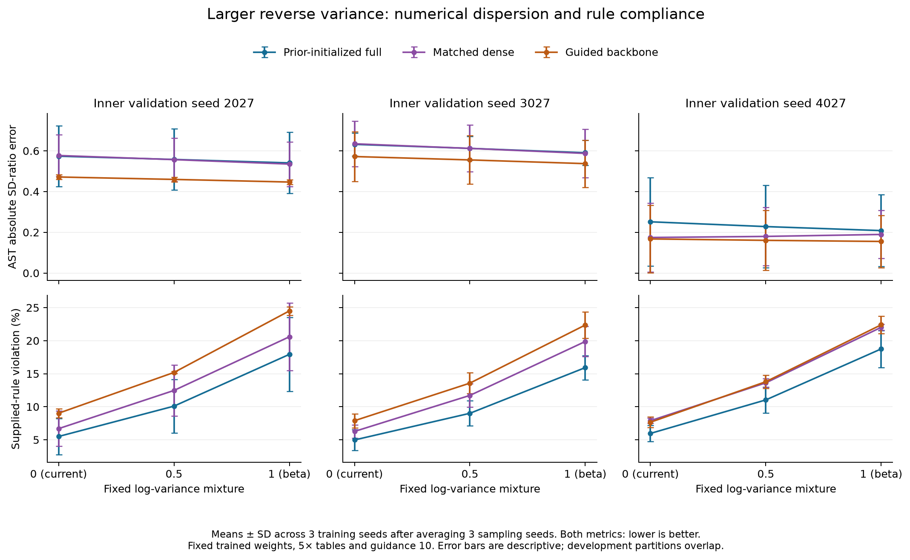

# Iteration 6: adding reverse noise does not resolve the distribution-shape failure

**162 new generated-table evaluations completed, compared with 162 reused references. No new generator models were trained.** Generation used 27 fixed prior-initialized checkpoints; the two generations of reference tables span 54 fitted models. All 324 comparison records passed the artifact audit, and 31 software tests passed. The original reserved test remains untouched.

## What was tested

For the full, matched dense and guided backbone models from iteration 5, we changed only numerical reverse variance. The current setting uses posterior variance; the two new settings interpolate halfway in log variance toward beta (m = 0.5), or use beta itself (m = 1). No noise is added at the final reverse step. The same trained weights, guidance 10, categorical transitions, random seeds, label order and sample counts are retained.

The design is motivated by established variance parameterizations in [Nichol and Dhariwal (ICML 2021)](https://proceedings.mlr.press/v139/nichol21a/nichol21a.pdf). We test fixed scalars; we did not implement their learned-variance image model or claim a new architecture. The [protocol](../../docs/ITERATION_6_PROTOCOL.md) and complete reference hashes were frozen before sampling.

## Some AST dispersion improves, while supplied-rule violations increase

Each entry averages three sampling seeds within each checkpoint, then three training seeds within each inner validation partition. These partitions overlap and are not independent clinical cohorts.

| Inner seed | Full-model variant | Forest AUROC | Numeric W | Any supplied-rule violation |
|---|---|---:|---:|---:|
| 2027 | Current prior-initialized sampler | 0.7383 | 0.3049 | 5.50% |
| 2027 | Log-variance mixture 0.5 | 0.7374 | 0.3043 | 10.09% |
| 2027 | Beta variance, mixture 1 | 0.7393 | 0.3085 | 17.93% |
| 3027 | Current prior-initialized sampler | 0.6991 | 0.2037 | 4.97% |
| 3027 | Log-variance mixture 0.5 | 0.7042 | 0.2144 | 9.01% |
| 3027 | Beta variance, mixture 1 | 0.7017 | 0.2355 | 15.92% |
| 4027 | Current prior-initialized sampler | 0.7076 | 0.2223 | 5.96% |
| 4027 | Log-variance mixture 0.5 | 0.7025 | 0.2381 | 11.03% |
| 4027 | Beta variance, mixture 1 | 0.6908 | 0.2631 | 18.76% |

On the previously failing AST partition 4027, mean absolute SD-ratio error improves from **0.2516 to 0.2281 and 0.2084**. Both exceed the targeted 0.01 improvement requirement. However, every full-model partition fails the supplied-rule violation guardrail against both the immediately preceding model and the original pre-initialization reference. Dense/backbone controls show the same broad compliance cost. No tested setting passes all criteria on any partition/reference combination, and no replacement recipe is exported.

Across the three partitions, protein-rule whole-table observed violation averages 4.03% for the current full sampler, 7.82% at mixture 0.5 and 14.26% at mixture 1. Negative direct-bilirubin values also increase from 1.44% to 2.31% and 3.59%. Rules are approximate/exploratory where documented; these are supplied-rule failures, not clinician-adjudicated invalid records. The counterexamples remain saved rather than silently repaired.

## A more specific diagnosis than “variance is too small”

The new quantile diagnostics show that AST's central spread is already too wide even when its total standard deviation is too small. On partition 4027:

| AST shape metric | Current sampler | Mixture 0.5 | Mixture 1 |
|---|---:|---:|---:|
| Synthetic / validation SD | 0.751 | 0.780 | 0.811 |
| Synthetic / validation interquartile range | 2.351 | 2.398 | 2.456 |
| Normalized 95th-quantile error | 0.751 | 0.693 | 0.635 |

The interquartile range measures the middle half of observed values. The new results therefore indicate a mismatch between central shape and tails, rather than uniformly narrow synthetic values. AST IQR ratios for the current prior-initialized model are also above one on partitions 2027 and 3027 (1.747 and 1.719). Increasing noise partly improves AST's upper quantile while broadening its already-wide middle further. These descriptive estimates come from small development cohorts; they are not population calibration claims.

Other features deteriorate substantially. On partition 4027, total bilirubin's mean absolute SD-ratio error increases by **0.296** at mixture 0.5 and **0.700** at mixture 1 versus the prior-initialized reference. Its normalized 95th-quantile error increases by **0.449** and **1.158**, exceeding the declared 0.10 tail-error tolerance. Improving a single AST metric therefore cannot justify adopting either sampler.

## Missingness, utility and privacy diagnostics

The earlier missingness improvement remains: none of the 162 new tables exceeds the 0.02 per-feature fit-error threshold; the worst error across new architectures/settings is about 0.00516. Full-model mean protein-rule coverage remains 99.15%, 99.19% and 99.55% across the three partitions. Added violation cannot be explained by pretending missing relationships are observed-valid; the audit recomputes coverage and whole-table bounds explicitly.

Forest and logistic utility changes are small/mixed, and several Wasserstein/association checks fail at larger variance. Full-model discriminator AUROC remains roughly 0.84–0.89 across the new settings/partitions. No exact predictor copy of a fit row was found in these comparison tables; this is not a privacy guarantee. All quantile, tail-frequency, augmentation and weak privacy diagnostics are retained in the CSVs.

## Publication consequence and next hypothesis

This study rejects a simple fixed-variance sampler correction under the predeclared engineering criteria. It also corrects an overly broad interpretation of earlier SD results: matching dispersion alone is insufficient when central shape and tails disagree. The paper now records that distinction and the failed controls. No thresholds were relaxed after outcomes were observed.

The next model-level experiment should address the numerical representation or denoising loss for skewed laboratory distributions while retaining fit-frequency observation initialization. Any transform must be fitted only on development-fit rows and preserve correct physical-unit clinical energies. This is a hypothesis to test, not an implemented or validated improvement. Further inference-time noise/guidance tuning alone is not supported by these results.

The study remains development evidence. Successful external-baseline reproduction, meaningful clinical rule review, incorrect-rule sensitivity, external cohorts, stronger privacy attacks, a frozen confirmatory protocol and researcher declarations are still outstanding before submission.

[Complete results](RESULTS.md), [all correction gates](correction_gates.csv), [selection record](selection.json), [commands and resource costs](../../docs/ITERATION_6_RUNBOOK.md), [PDF figure](figures/variance_tradeoff.pdf), [SVG figure](figures/variance_tradeoff.svg).
