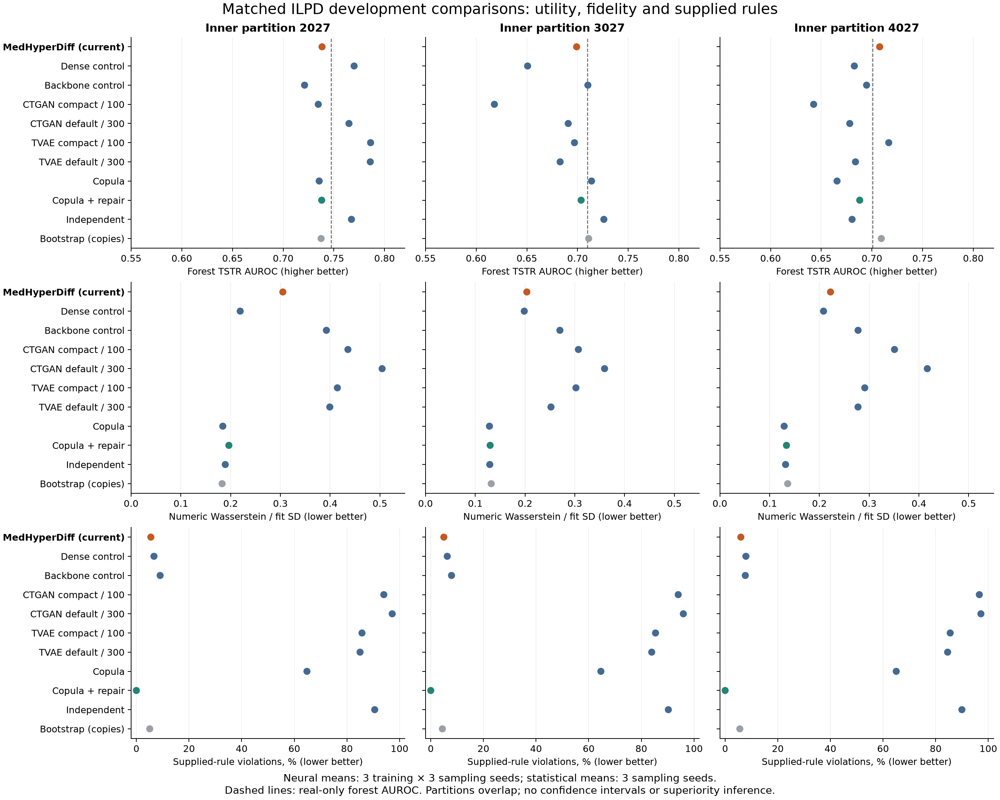

# Iteration 7: stronger comparisons change the publication priority

**The current model does not consistently beat the baselines.** This stage closes the mismatch between the older CTGAN/TVAE pilots and the current ILPD development evaluation. It also exposes a strong simple repair comparator and corrects the interpretation of literal exact-copy diagnostics. It does not establish publication-ready superiority or train new MedHyperDiff weights.

## Completed work

36 new CTGAN/TVAE adapter fits contain **72 separately trained class networks**. Nine additional statistical reference fits require no neural optimization. There are 135 newly sampled tables plus nine repaired copula derivatives, giving **144 new evaluations**; 81 prior full/dense/backbone evaluations are reused, for **225 comparison records**. Fitting seeds and sampling seeds are distinct. These counts exclude software-test fixtures.

All arms use the same three ILPD fit/validation partitions, exact fit-label vectors repeated five times, synthetic counts of 1,745 or 1,750 and downstream evaluator seed 2026. Neural means average three sampling seeds inside each checkpoint and then three training seeds. Statistical means average three sampling seeds from one deterministic fit per partition. The original reserved test set remains excluded. The partitions overlap and cannot support independent-cohort significance claims.

## Predictive utility

Forest AUROC when trained on synthetic data and evaluated on real development validation, higher is better:

| Generator / preset | Inner 2027 | Inner 3027 | Inner 4027 |
|---|---:|---:|---:|
| Current MedHyperDiff, full_prior | 0.7383 | 0.6991 | 0.7076 |
| Dense control | 0.7700 | 0.6507 | 0.6826 |
| Guided backbone control | 0.7211 | 0.7102 | 0.6947 |
| CTGAN compact, 100 epochs | 0.7346 | 0.6180 | 0.6425 |
| CTGAN native defaults, 300 epochs | 0.7649 | 0.6908 | 0.6781 |
| TVAE compact, 100 epochs | 0.7862 | 0.6969 | 0.7166 |
| TVAE native defaults, 300 epochs | 0.7859 | 0.6828 | 0.6838 |
| Empirical Gaussian copula | 0.7355 | 0.7138 | 0.6656 |
| Copula plus explicit repair | 0.7380 | 0.7035 | 0.6880 |
| Independent marginals | 0.7674 | 0.7260 | 0.6804 |
| Bootstrap: memorization control | 0.7374 | 0.7110 | 0.7093 |
| Real-only forest reference | 0.7473 | 0.7098 | 0.7006 |

Current full exceeds compact CTGAN on all three partition means and each default-size neural preset on two of three. However, compact TVAE exceeds full on two of three, and the partition-3027 difference in full's favor is only 0.0021. Larger capacity/longer nominal training does not guarantee a stronger outcome. All presets therefore remain reported; choosing only default300 would overstate our comparative utility. Logistic and augmentation results are retained separately and do not support an across-metric winner.

## Fidelity and supplied rules

| Inner seed | Full numeric W | Repaired copula numeric W | Full association RMSE | Repaired copula association RMSE | Full violation | Repaired copula violation |
|---|---:|---:|---:|---:|---:|---:|
| 2027 | 0.3049 | 0.1964 | 0.1843 | 0.0898 | 5.50% | 0.00% |
| 3027 | 0.2037 | 0.1299 | 0.1489 | 0.0615 | 4.97% | 0.00% |
| 4027 | 0.2223 | 0.1338 | 0.1932 | 0.0869 | 5.96% | 0.00% |

Numeric W is mean numeric Wasserstein distance normalized by fit SD; lower is better. Full has lower numeric W and fewer supplied-rule violations than every CTGAN/TVAE preset in all three partitions. Default CTGAN violations are 95.98–97.21%, and default TVAE violations are 83.96–84.99%. These are successful executable native-package fits with poor preservation of these supplied relations, not confirmation that they reproduce published benchmark performance.

The repaired copula is a stronger challenge: it has lower numeric W, association error and observed supplied-rule violations in every partition. Forest AUROC is effectively tied on 2027 (+0.0003 for full), favors repair on 3027 (+0.0044), and favors full on 4027 (+0.0197). Logistic favors full in the first two partitions and repair in the third. C2ST AUROC is 0.563–0.588 for repaired copula versus 0.847–0.879 for full (0.5 is chance discrimination). Repair changes approximately 99.2–99.5% of rows, including imposing the protein identity even when originally within tolerance; it is an explicit distribution-changing operation. Raw copula outputs are retained. Protein-rule coverage remains approximately 99.2–99.5%, so zero observed violations does not certify unknown cases or clinical validity.

This result prevents attributing a compelling medical-data contribution to compliance alone. The learned structure needs an advantage in utility, distribution shape, reviewed clinically meaningful relationships, or robustness that simpler repair cannot provide. Neither the present full_prior variant nor the failed variance settings are promoted to a new exported default.

## Measurement correction and privacy

The bootstrap positive control revealed that standardized float32 round trips alter original numeric values slightly: literal whole-row hashes report **0% exact matches even for training resampling**. Strict min/max and quantile boundary checks can similarly turn perturbed ties into apparent tail or extrapolation differences. The original metrics remain intact for reproducibility.

A documented [post-protocol addendum](../../docs/ITERATION_7_DIAGNOSTIC_ADDENDUM.md) adds profile matching with numerical tolerance `1e-6 * max(fit SD, 1)` per feature, while requiring matching categories and missingness. All nine bootstrap tables correctly show **100% near-copies of training profiles** and zero tolerance-aware extrapolation. The other arms show zero near-copies at this small numerical tolerance, which still provides no privacy guarantee. Retained nearest-distance attacks and stronger future attacks matter beyond literal or near-copy counts. Use `tolerant_boundaries_all.csv` when interpreting boundary frequencies; earlier strict counts are sensitive to floating-point ties.

## Verification, costs and limitations

All **225 records** pass provenance/split/rule/missingness/shape checks and **1,350 saved AUROCs** are recalculated. All **45 new fitted objects** reproduce their first sampling table exactly; all **nine repaired derivatives** reproduce exactly. The supplemental diagnostic passes all 225 records and its bootstrap positive control. **34 software tests pass**, including three new checks for numerical copies, genuine differences, missingness/category disagreement and boundary perturbations.

CPU fitting, sampling/repair and evaluation components total 115.0, 4.8 and 127.0 seconds, about **4.1 minutes combined**. This excludes audits, reporting, loading and other overhead; it is not end-to-end wall time. GPU VRAM use is **0 GiB**. Peak system RAM and GPU runtime were not measured. See the [runbook](../../docs/ITERATION_7_RUNBOOK.md).

Data, labels, output count and evaluation match, but optimization and tuning opportunity are unequal. Our method has undergone repeated development selection and validation checkpointing. Native baselines use two frozen capacity/budget presets, per-label fits and fixed endpoints. Different batch sizes mean epoch counts do not imply equal update counts or compute. This comparison is not a tuned confirmatory benchmark. Stable external diffusion reproduction, external cohorts, clinical rule review, wrong-rule sensitivity, stronger privacy tests and final researcher declarations remain outstanding.

## Next priorities

1. Use repaired copula, both TVAE presets, dense and guided-backbone controls as required references. Resolve a stable external diffusion baseline; retain unsuccessful TabDDPM attempts and do not claim TabDiff was trained.
2. Test a fit-only representation for heavy-tailed laboratory values, carrying its inverse and derivative correctly into physical-unit constraints. Preserve the observation initialization. Judge central spread, quantiles, association and utility together, using tolerance-aware boundary checks; do not optimize SD in isolation.
3. Test wrong-rule sensitivity and clinically reviewed relationships on additional cohorts, then freeze a common tuning and confirmatory protocol. Current overlapping development comparisons cannot substitute for that evidence.

[All results](RESULTS.md), [artifact audit](ARTIFACT_AUDIT.json), [numerical diagnostic audit](NUMERICAL_DIAGNOSTIC_AUDIT.json), [frozen protocol](../../docs/ITERATION_7_PROTOCOL.md).
