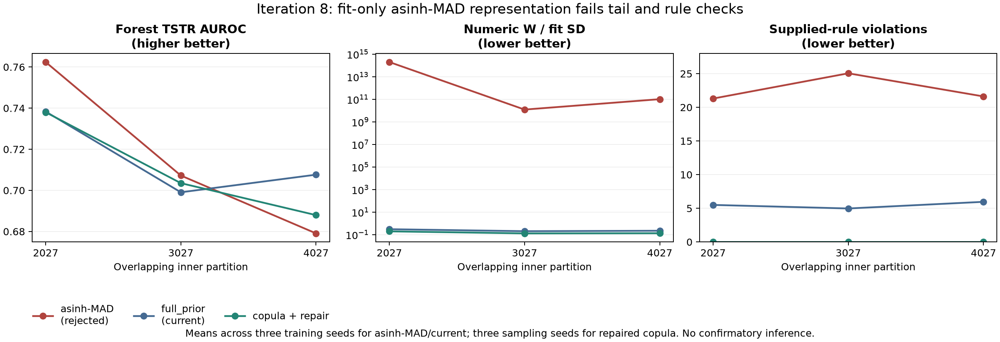

# Iteration 8: robust numerical representation was rejected

This stage tested one predeclared fit-only numerical representation to address the central-versus-tail mismatch. It is a negative development result and is not promoted to the model or sampler.

For each numeric feature, the fit partition supplied a median and MAD-based scale, followed by a monotone `asinh` transform and fit-only standardisation. A differentiable inverse was used inside the existing physical-unit constraint energy. The same observation-head initialisation, velocity backbone, graph/hypergraph structure, training budget, adaptive guidance, label order, evaluator and fivefold-size output were retained. Nine models were fit and 27 tables evaluated across the three overlapping development partitions. The outer test remained closed.

| Arm | Inner 2027 forest | Inner 3027 forest | Inner 4027 forest | Numeric W | Rule violation |
|---|---:|---:|---:|---:|---:|
| Current full_prior | 0.7383 | 0.6991 | 0.7076 | 0.3049 / 0.2037 / 0.2223 | 5.50% / 4.97% / 5.96% |
| asinh-MAD representation | 0.7624 | 0.7072 | 0.6791 | 1.99e14 / 1.22e10 / 1.02e11 | 21.31% / 25.06% / 21.62% |
| Repaired copula | 0.7380 | 0.7035 | 0.6880 | 0.1964 / 0.1299 / 0.1338 | 0.00% / 0.00% / 0.00% |

The transformed model's forest utility is higher than full_prior on partitions 2027 and 3027 but lower on 4027. Logistic utility is likewise mixed. That apparent utility improvement is not usable because source-unit decoding creates extreme outliers: total bilirubin reaches approximately `8.0e19` in one saved table, and direct/total bilirubin and ratio features produce enormous standard-deviation errors. Mean numeric Wasserstein error is consequently dominated by a small number of pathological values. Observed supplied-rule violation rises to roughly 21–25%, compared with roughly 5–6% for full_prior. Feature-wise 95th-quantile errors and fit-range exceedance remain poor for bilirubin, ALT, AST and alkaline phosphatase. Missingness itself remains controlled: the largest feature missingness error is 0.0018–0.0025, so this failure is numerical decoding and clinical consistency rather than mask frequency.

The physical-unit energy implementation passed a unit test against the affine representation when evaluated on identical physical records. All output tables are finite, and the extreme values are retained for audit. This means the failure is not an implementation crash or an invalid inverse; it is a valid but unsuitable learned-coordinate distribution. A monotone transform alone does not control the denoiser's generated tail. Adding a post-hoc clip would change the proposed experiment and risk hiding the failure, so no clip was added.

## Audit and cost

The artifact audit checks 27 new and 36 reused records, 378 saved AUROCs, split isolation, physical-unit metric recomputation and nine exact first-seed checkpoint replays. The study uses 52.5 seconds of fitting, 38.4 seconds of sampling and 25.7 seconds of evaluation components on the local CPU, about 1.9 minutes excluding audit/report overhead. GPU VRAM is 0 GiB; peak system RAM was not measured. The full software suite now has 36 passing tests.

The result narrows the next method choice. Preserve the observation-frequency initialization, reject this asinh-MAD coordinate as a default, and stop broad transform tuning on ILPD. The next publication-relevant work is an externally reviewed rule/sensitivity protocol and a confirmatory cohort design. If another numerical representation is considered, it should include an explicit tail-stability mechanism or bounded support justified by the data-generating task before fitting, and it must be evaluated against the repaired copula and full_prior under a frozen protocol.

[Complete tables](RESULTS.md), [artifact audit](ARTIFACT_AUDIT.json), [frozen protocol](../../docs/ITERATION_8_PROTOCOL.md), [runbook](../../docs/ITERATION_8_RUNBOOK.md).
